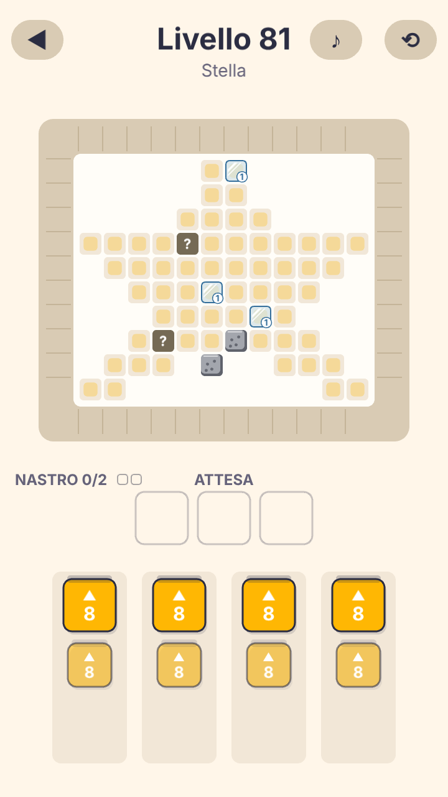
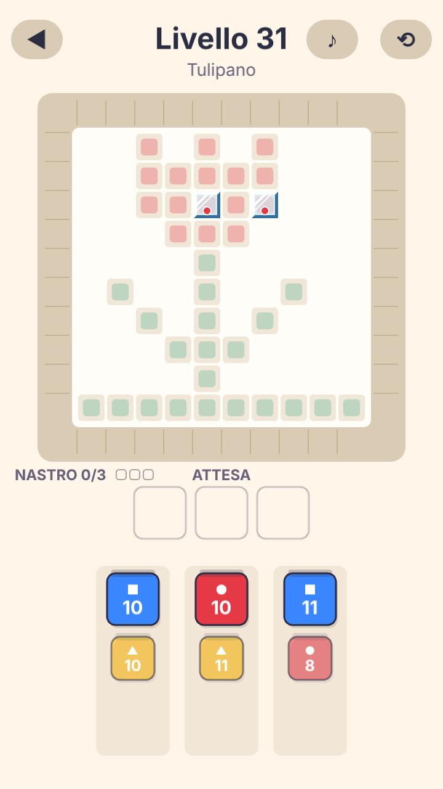

# #150 — Pixel ghiacciato: due direzioni a confronto

**Problema** (playtest agent, [report §3, F6](../reports/2026-10-31-playtest-agent.md)): 4 agent su 8 non riconoscono il ghiaccio. Lo leggono come "girandola", "snowflake", "cracked cube". A01 al livello 111: "quadratini azzurri con una girandola bianca". Il bordo scuro di #176 ha reso il pixel più visibile, ma le tre crepe che partono dal centro disegnano proprio una girandola. In più nulla dice quanti colpi servono.

**Vincoli:** grafica solo via codice, token solo da `src/game/theme.ts` (direzione "Gouache Studio"), celle da 33 a 59 unità logiche (cioè da 16 a 30 px CSS a 360×640), nessuna animazione nuova.

Riferimento "prima": `docs/test-evidence/176-feedback-chiarezza/05-ghiaccio-e-pietre-81-360x640.png`.

## A — "Lastra" con contatore numerico
Copertura di brina e bordo `iceDark` (come in #176). Le crepe diventano **due riflessi bianchi paralleli in diagonale**, il segno universale di vetro e ghiaccio levigato. In basso a destra c'è un **disco bianco con il numero dei colpi** che rompono il ghiaccio, in `iceDark`.

| Livello 31 (celle 47) | Livello 81 (celle 39) |
|---|---|
|  |  |

## B — "Cubetto" con puntini di colore
Smusso 3D: un bordo chiaro in alto e a sinistra, uno scuro `iceDark` in basso e a destra. Poi gli stessi due riflessi e **un puntino del colore del pixel per ogni colpo**, che riprende il linguaggio dei puntini di #149.

| Livello 31 | Livello 81 |
|---|---|
|  |  |

## Scelta: A
- **Il contatore si legge.** Il "1" nel disco bianco si vede anche sulle celle da 39 a 360×640. Il puntino di B, con un raggio minimo di 4, sparisce sotto la brina e non dice "quanti": si capisce solo con due o più strati.
- **Si legge come ghiaccio.** I riflessi diagonali con il bordo scuro fanno pensare a una lastra di vetro o di ghiaccio, e non partono più dal centro, quindi la girandola sparisce. Lo smusso asimmetrico di B, con la banda scura solo in basso a destra, sembra un adesivo piegato più che un cubetto.
- **Coerente con la scheda.** La scheda dice "due colpi: il primo rompe il ghiaccio, il secondo dipinge". Il numero conta i colpi che rompono il ghiaccio, e la scheda ora lo dice in una riga: "Il numero sul ghiaccio: i colpi che mancano per romperlo".
- **Costo.** Il numero è un testo: la scena lo crea una volta per pixel e lo distrugge quando il ghiaccio si rompe, come il "?" dei pixel nascosti.

## Implementazione
- `src/core/ice.ts` (puro, testato in `tests/ice.test.ts`): `iceHits`, `iceGlints` (geometria dei riflessi), `iceBadge` (posizione e raggio del contatore, minimo 7, dentro il pixel con il suo bordo).
- `src/game/ui.ts`: `drawIce` disegna brina, bordo, riflessi e disco; `iceCounter` crea il numero. Si usano sul tabellone, sulla scheda del ghiaccio e sulla scheda della corsia bloccata.
- Token: `THEME.iceDarkCss` per il numero, con contrasto 5,5:1 sul disco bianco.
