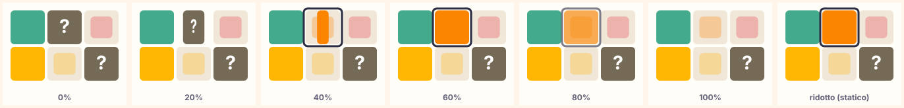
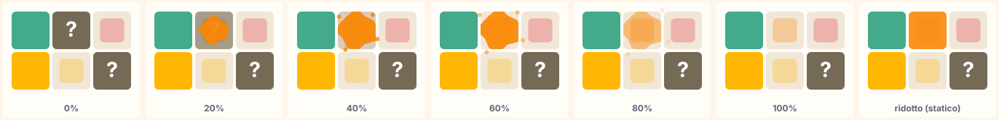
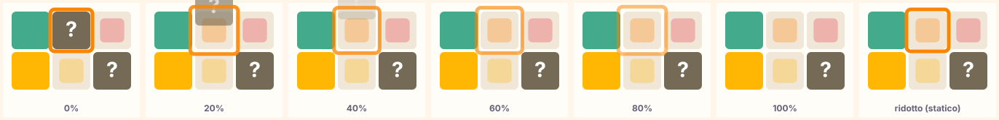

# #152 — Pixel "?": tre direzioni per il momento della rivelazione

**Problema** (playtest agent, [report §3, F8](../reports/2026-10-31-playtest-agent.md)): la rivelazione dei pixel nascosti non si nota. A08 al livello 188: "I never saw one turn into a colour". Oggi il pixel passa di colpo dalla copertura scura al pixel vuoto con il fantasma del colore al 30%, e un cerchio bianco di 300 ms si perde nello schizzo del colpo sul vicino. Il risultato sembra un pixel vuoto, non un colore scoperto.

**Vincoli:** grafica solo via codice, token solo da `src/game/theme.ts` (direzione "Gouache Studio"), celle da 33 a 59 unità logiche, `prefers-reduced-motion` rispettato con un segnale statico ma percepibile.

Fotogrammi resi da codice (canvas con i token del tema): un tabellone 3×2 con il pixel nascosto in alto al centro (colore arancione) accanto al verde appena completato. Sei istanti dell'animazione, poi la variante con movimento ridotto.

## A — "Tessera girata"
La copertura si gira come una carta: si stringe in orizzontale con il suo "?" (0–35 %), poi la faccia si allarga **piena del colore scoperto** con un **bordo d'inchiostro** (35–70 %), infine sfuma nel pixel da dipingere con il fantasma al 30 % (fino al 100 %). 700 ms in tutto.

Movimento ridotto: nessuna rotazione. La cella mostra subito il colore pieno con il bordo d'inchiostro, ferma, per 1,2 s; poi passa in un taglio netto allo stato da dipingere.

## B — "Velo che si scioglie"
La copertura sbiadisce mentre al centro sboccia una macchia di gouache del colore scoperto, con qualche gocciolina, che poi si ritira nel fantasma.

Movimento ridotto: la cella si riempie del colore all'85 %, poi torna allo stato da dipingere.

## C — "Etichetta che vola"
La copertura col "?" si stacca e vola via verso l'alto come il lucchetto (#98), e un anello del colore scoperto pulsa due volte intorno alla cella.

Movimento ridotto: l'anello colorato resta fermo intorno alla cella.

## Scelta: A
- **Si vede il colore.** La frase del playtest è "non l'ho mai visto diventare un colore": A e B mostrano il colore pieno su tutta la cella. C mostra solo un anello sottile attorno a un fantasma al 30 %, cioè lo stesso stato poco leggibile di oggi.
- **È lo stesso gesto del secchiello coperto.** Il secchiello col "?" (#97) già si gira stringendosi in orizzontale (`columnFace`, 420 ms). Usare lo stesso gesto per il pixel col "?" insegna una sola regola: "il ? si gira e sotto c'è il colore".
- **Si distingue dallo schizzo.** B usa una macchia di vernice, che è proprio la firma di ogni colpo: arriva insieme allo schizzo sul vicino e ci si confonde. La rotazione e il bordo d'inchiostro di A non somigliano a nient'altro sul tabellone.
- **Movimento ridotto.** Il colore pieno con il bordo d'inchiostro per 1,2 s è statico ma impossibile da non vedere. Il bordo lo distingue da un pixel finito, che non ha bordo.
- **Costo.** Un solo `Graphics` ridisegnato solo mentre una rivelazione è in corso. Il "?" esistente si stringe con `setScale`, senza testi nuovi.

## Implementazione
- `src/core/reveal.ts` (puro, testato in `tests/reveal.test.ts`): durate e `pixelRevealFrame(elapsed, reduced)`, che dà per ogni istante la larghezza della copertura e della faccia, l'opacità del colore pieno e del bordo, e quando la rivelazione è finita.
- `PlayScene`: la rivelazione parte quando la goccia arriva sul vicino (prima il pixel resta coperto). Lo stato è pubblicato su `window.__mix.pixelReveal` per lo spec e2e `e2e/reveal-152.spec.ts`.
