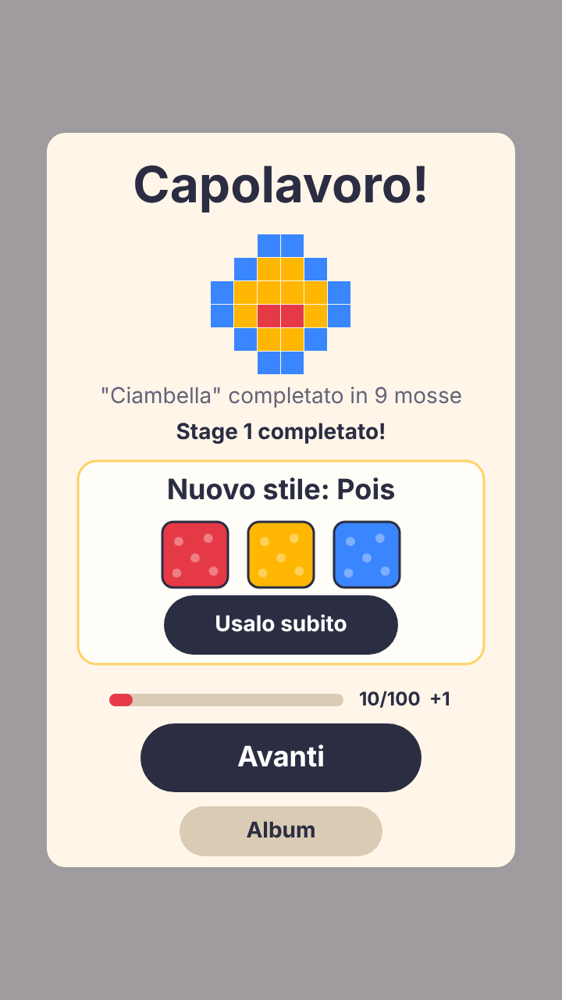
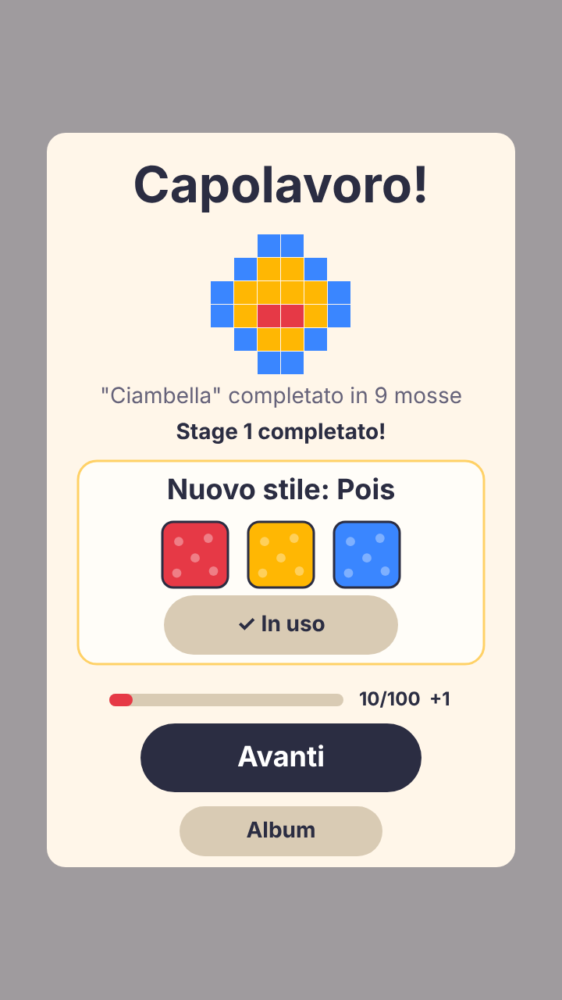
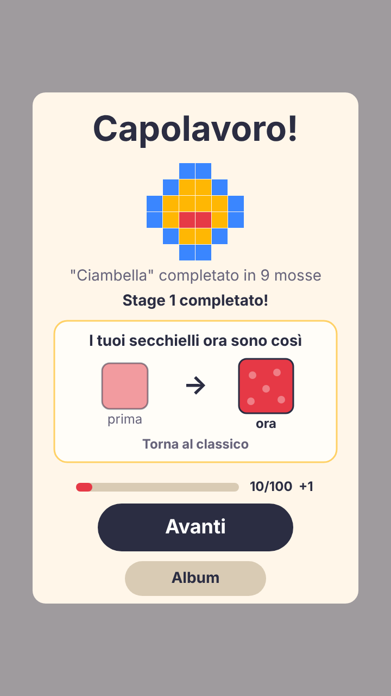
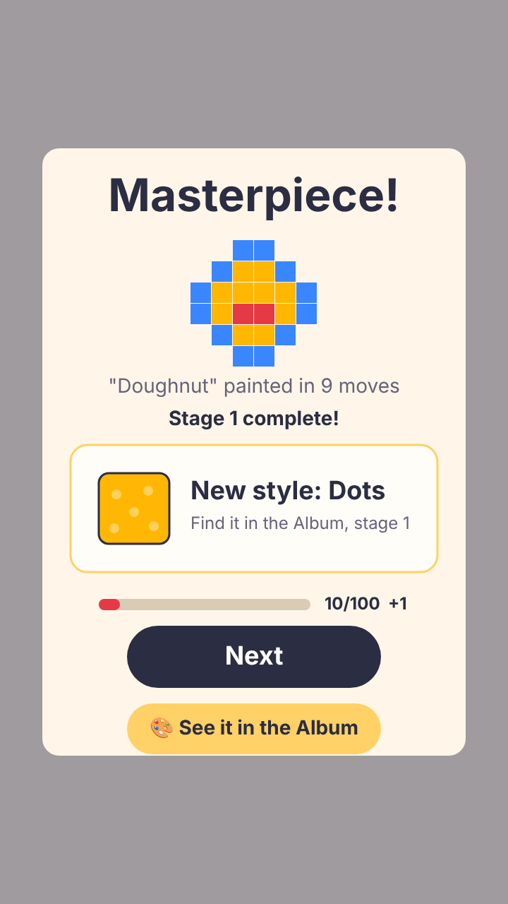

# #153 — Ricompensa di fine stage: tre direzioni per il pannello vittoria

**Problema** (playtest agent, [report §3, F9](../reports/2026-10-31-playtest-agent.md), 6 agent): a fine stage il pannello diceva "Nuovo stile dei secchielli" e (dal #177) "Tocca Album per vedere tutti gli stili", ma non mostrava lo stile né lo metteva sui secchielli. A01 al 120: "Non ho visto nessun cambio"; A08 al 190: "cosmetic".

**Vincoli:** grafica solo via codice, token solo da `src/game/theme.ts` ("Gouache Studio"), lo stile disegnato da `drawSkin` come nell'album, testi IT/EN, pannello dentro lo schermo a 360×640 e 412×915 in entrambe le lingue, nessun tocco accidentale (i bottoni restano armati dopo 450 ms come gli altri del pannello, #161).

Fotogrammi resi da codice: `scripts/design/153-mock.ts` disegna il pannello su un canvas con i token del tema e il vero `drawSkin`; `node scripts/design/153-render.mjs` rigenera le immagini e controlla che ogni pannello stia nei bordi a 360×640 e 412×915, in IT e EN. Lo stile mostrato è "pois", il premio dello stage 1.

## A — "Tre barattoli e Usalo subito"
Sotto la riga dello stage, una scheda con il bordo oro mostra lo stile su tre barattoli (rosso, giallo, blu), come la pagina dell'album. Sotto, **Usalo subito** lo mette sui secchielli; il bottone diventa **✓ In uso**. Il bottone Album resta dov'era. Il quadro si rimpicciolisce (240 → 180) per fare spazio.

 

## B — "Applicato da sé, prima → ora"
Lo stile viene messo subito sui secchielli, senza chiedere: la scheda mostra il secchiello di prima, una freccia e quello di ora, con un link "Torna al classico".

## C — "Rimando all'album"
Una scheda orizzontale con un barattolo e il testo "Lo trovi nell'Album, stage 1"; il bottone Album diventa oro con la tavolozza, per attirare il tocco. Nessuna azione nel pannello.

## Scelta: A
- **Si vede e si usa subito.** Il finding è "non ho visto nessun cambio": A mostra lo stile su tre colori (si capisce che è un motivo, non un colore) e con un tocco lo porta sui secchielli del livello dopo. C mostra lo stile ma lascia il cambio a una pagina in più, cioè proprio il passaggio che gli agent non hanno fatto.
- **Il giocatore sceglie.** B cambia l'aspetto dei secchielli senza chiederlo: chi preferiva un altro stile (o il classico, più leggibile) se lo ritrova cambiato a ogni fine stage, e "Torna al classico" sbaglia quando lo stile di prima non era il classico.
- **Lo stesso linguaggio dell'album.** Tre barattoli e un bottone "Usalo" esistono già nella pagina dello stage (`AlbumScene.drawReward`): il pannello insegna dove ritrovarli, e "Tocca Album per vedere tutti gli stili" (#177) resta sotto la scheda come rimando.
- **Spazio.** Il pannello passa da 760 a 940 unità solo quando c'è un premio; sta nei 1280 dello schermo più corto (360×640) con il titolo dello stage su due righe in italiano.

## Implementazione
- `src/core/album.ts`: `stageReward(stage, skinInUso)` dice quale stile dà lo stage appena finito e se è già in uso. `src/core/progress.ts`: `useSkin(progress, skin, livelli)` mette uno stile guadagnato e rifiuta uno non sbloccato (usato dal pannello e dall'album via `store.setSkin`). `src/core/winPanel.ts`: posizioni del pannello con e senza premio. Unit test in `tests/album.test.ts`, `tests/progress.test.ts`, `tests/winPanel.test.ts`.
- `PlayScene.showWin` disegna la scheda; `window.__mix` pubblica `reward`, `skin` e `winButtons.use` per lo spec `e2e/reward-153.spec.ts`.
