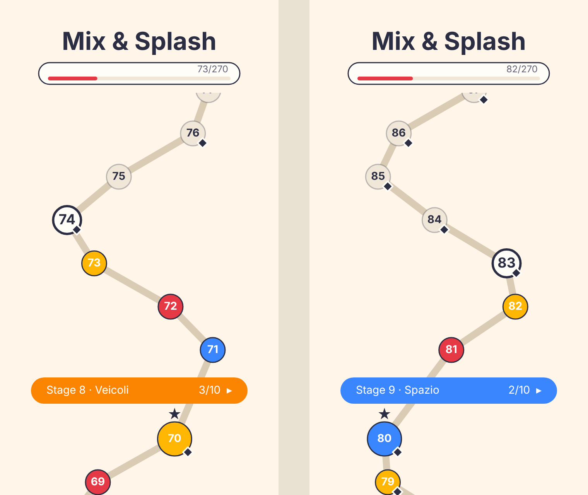
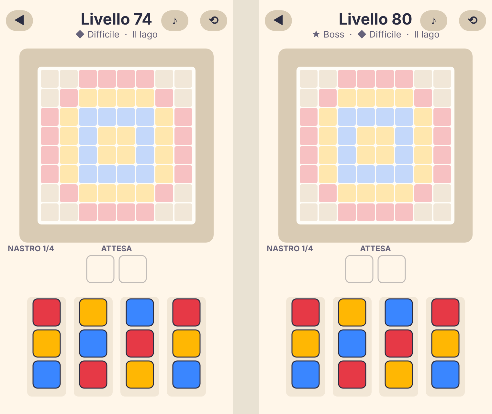
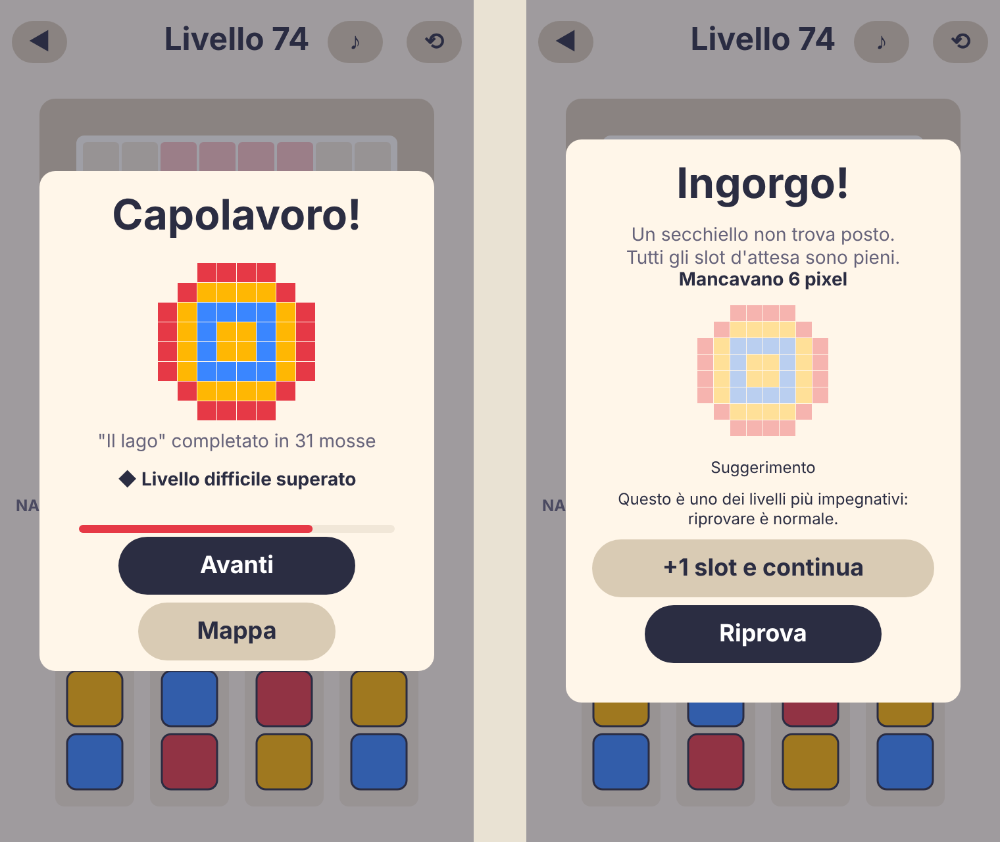
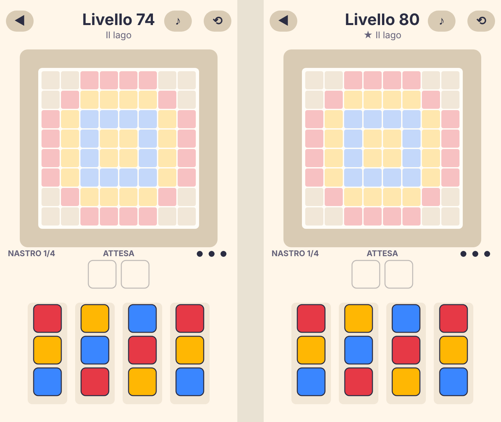
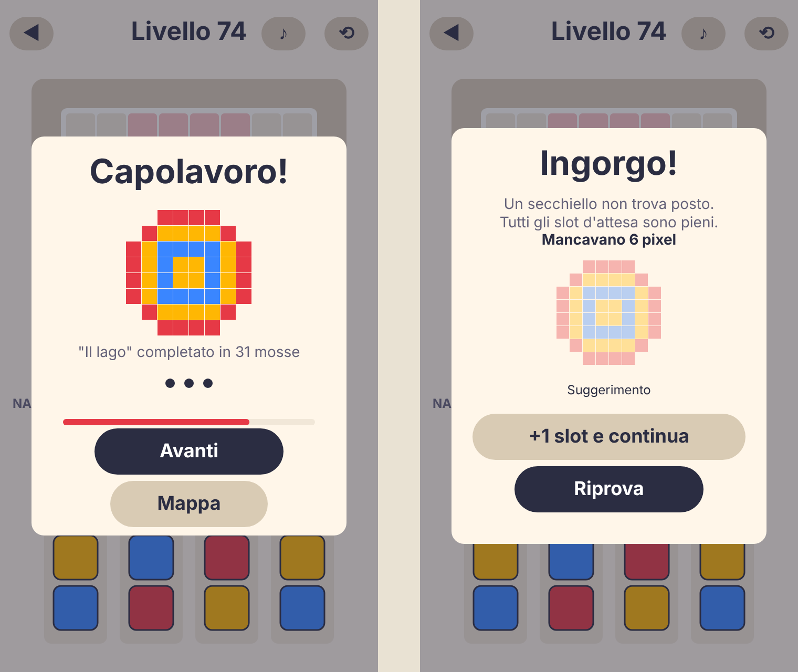
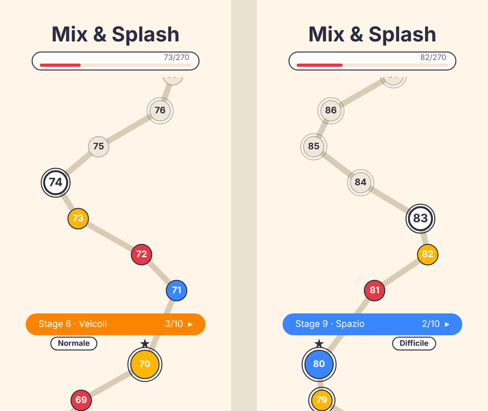
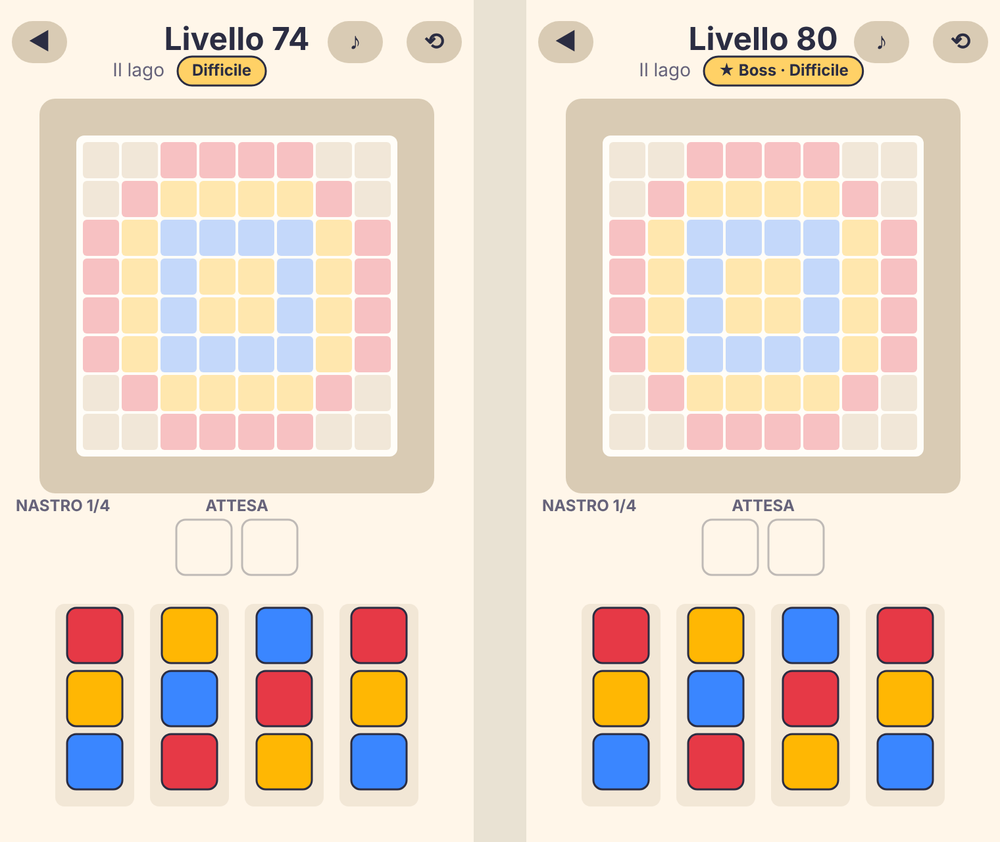
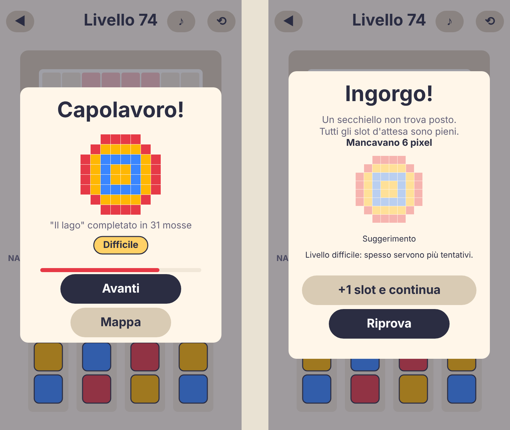

# #73 — Difficoltà su mappa e livello: tre direzioni

**Problema:** il calcolo della difficoltà esiste (#72: fascia Facile / Normale / Difficile per livello, boss come flag, fascia di stage = media dei 10 livelli, `src/core/difficulty.ts`). Questo ticket decide **come** mostrarla, senza appesantire le schermate e senza far sentire "sbagliato" chi perde.

**Vincoli:** direzione "Gouache Studio" (`docs/design/README.md`), token solo da `src/game/theme.ts`; l'informazione non dipende dal solo colore (forma, icona o testo); zone toccabili ≥ 44 px (#49); mappa fluida (nessuna draw call in più per nodo, culling #46/#60: i segni vanno nel `Graphics` condiviso dei nodi, i testi restano `lazy`); 360×640 e telefoni alti (#62); testi solo in `src/core/i18n.ts` IT/EN; nessun numero di stage fisso; nessuna migrazione dei salvataggi (la difficoltà non è nei progressi); nessun asset di terzi.

Fotogrammi resi da codice (come #77): `scripts/design/73-mock.ts` usa i token, i layout veri (`computeMapLayout`, `computeLayout`, `winPanelLayout`) e le **fasce reali** di `src/levels/difficulty.json`; `node scripts/design/73-render.mjs` rigenera le 18 immagini in `docs/design/73-difficolta-ui/`. Ogni immagine ha due telefoni 360×640. I testi proposti stanno nel mock (`STR`), non in `i18n.ts`: li aggiungerà il ticket di implementazione.

## Cosa dicono i dati (prima di scegliere)
Dai 270 livelli oggi in `difficulty.json`:
- **29 % Difficile (78)**, 51 % Normale (137), 20 % Facile (55). Nessuno stage ha più di 8 livelli difficili; gli stage 1–3 ne hanno 0, gli stage 9, 10, 20 e 27 ne hanno 5 o più. Un segno solo sui "difficili" è quindi discreto nei primi stage e **fitto** nei cluster duri (stage 9 nel secondo telefono della mappa).
- **Boss: 24 su 27 sono Difficili.** "★ Boss" e "Difficile" quasi sempre vanno insieme: mostrarli entrambi è ridondante (i fotogrammi lo mostrano comunque, nel caso peggiore).
- **Fascia di stage: 18 stage su 27 sono "Normale"**, 5 Difficile, 4 Facile. Un'etichetta di stage dice quasi sempre la stessa parola: informa poco proprio dove costa più spazio (l'intestazione ha già titolo e contatore, e il titolo si restringe a 20 px, #160).
- **Facile su un livello perso è una frecciata.** Chi perde il livello 6 e legge "Facile" si sente giudicato. Regola comune a tutte le direzioni: la parola **Facile non compare mai** nella schermata di gioco né nei pannelli di fine livello.

## Regole comuni
- **Tono.** Nessun testo dà un voto a chi gioca. Nei pannelli la difficoltà parla del *livello*, mai della persona: "Questo è uno dei livelli più impegnativi: riprovare è normale", non "Hai fallito un livello difficile". Nessun segno, parola o suono in più sul pannello Ingorgo che non sia di conforto.
- **Dove vive il dato.** Una funzione pura sul calcolo esistente (`levelDifficulty`, `stageDifficulty`) e una tabella compatta di fasce per id, generata da `gen:levels` accanto a `difficulty.json` (un carattere per livello, ~270 byte invece dei 24 KB del file completo, che resterebbe nel bundle). Niente nel salvataggio: la fascia è funzione del livello, quindi **nessuna migrazione**; un livello nuovo ha la sua fascia appena `gen:levels` lo misura.
- **Fuori dal culling.** I segni sui nodi sono disegni nel `Graphics` già condiviso da `drawNodes` (zero oggetti in più); i testi nuovi, dove ci sono, passano da `lazy`.
- **Tocchi.** Nessun segno è un bersaglio: l'hit-test resta su nodi e intestazioni (`mapTapTarget`). I segni non intercettano tocchi; i pill del livello non sono interattivi, quindi il vincolo di 44 px non li tocca (nessun bottone nuovo).
- **Priorità sul pannello vittoria.** La riga della difficoltà occupa lo slot della riga di stage (offset 460) solo se il livello non completa uno stage: il messaggio di stage resta sempre in testa.
- **Un solo numero nel codice.** Soglie e fasce restano in `DIFFICULTY` (`difficulty.ts`); la UI legge `band` e `boss`, non rifà conti.

---

## A — "Pochi segni" (la proposta di partenza)
Solo le eccezioni: **Difficile** e **Boss**. Nessuna etichetta di fascia sullo stage.

- **Mappa:** un piccolo rombo d'inchiostro ◆ con bordo carta in basso a destra del nodo difficile; il boss ha già la ★. L'intestazione di stage non cambia.
- **Gioco:** la riga del sottotitolo (sotto "Livello 74") diventa "◆ Difficile · Il lago" (boss: "★ Boss · ◆ Difficile · Il lago"); nei livelli normali e facili la riga resta com'è: **nessuna etichetta**, quindi niente da leggere e niente frecciate.
- **Pannello vittoria:** una riga sobria "◆ Livello difficile superato" dove sarebbe la riga di stage.
- **Pannello ingorgo:** solo dopo tre sconfitte di fila (la stessa soglia che già mostra il tasto "Suggerimento", `defeatsOn` in `progress.ts`) e solo su un livello difficile, una riga di conforto: "Questo è uno dei livelli più impegnativi: riprovare è normale." Il pannello cresce di 64 unità solo in quel caso.

EN: [mappa](73-difficolta-ui/map-A-en.png) · [gioco](73-difficolta-ui/play-A-en.png) · [fine livello](73-difficolta-ui/end-A-en.png)

**Pro**
- Costo visivo minimo: il 71 % dei nodi non cambia e il testo si aggiunge solo dove serve.
- Forma + parola (rombo e "Difficile"): l'informazione non è mai solo colore.
- Il rombo sta nel `Graphics` dei nodi: nessuna draw call o oggetto in più, il culling non cambia.
- Tono sicuro: chi vince un livello facile o normale non legge nulla; chi perde un difficile trova conforto.

**Contro**
- Nei cluster duri (stage 9: 8 difficili su 10) quasi ogni nodo ha il rombo, e il segno perde forza: dice "tutto è difficile" invece di orientare.
- Chi vuole sapere "quanto è lungo il tratto duro" non ha una vista d'insieme dello stage.
- Boss e Difficile quasi sempre insieme: la riga "★ Boss · ◆ Difficile" è ridondante (si può accorciare a "★ Boss" quando il boss è difficile, tenendo il rombo solo per il boss normale).
- Il rombo a 360 px è piccolo (13 unità di raggio): leggibile, ma vicino al bordo del nodo.

**Costo implementativo: basso.** ~1 funzione pura (selettore), rombo in `drawNodes`, una `label` nel sottotitolo, due righe di testo × 2 lingue; test unit sul selettore, e2e "il nodo difficile ha il segno" via stato pubblicato da `publish()` (già espone `nodes`).

---

## B — "Tre puntini" (graduale, senza parole sulla mappa)
Un solo linguaggio, tre livelli: ● ○ ○ facile, ● ● ○ normale, ● ● ● difficile. Compare ovunque, senza parole.

- **Mappa:** i tre puntini sotto ogni nodo (cerchietti pieni o con solo contorno: il conteggio non dipende dal colore) e sotto l'intestazione dello stage, per la media dei dieci livelli.
- **Gioco:** i puntini a destra, sulla riga del contatore "NASTRO 1/4" (quella riga ha libera la parte destra); il boss ha la ★ davanti al nome.
- **Pannelli:** vittoria con i tre puntini al posto della riga di stage; **ingorgo senza alcun segno**: un livello perso non si valuta.

EN: [mappa](73-difficolta-ui/map-B-en.png) · [gioco](73-difficolta-ui/play-B-en.png) · [fine livello](73-difficolta-ui/end-B-en.png)

**Pro**
- Mostra tutte e tre le fasce, quindi anche la gradualità dello stage; nessuna lingua (zero testi nuovi in `i18n.ts`, tranne un'etichetta di accessibilità).
- Zero testo da `lazy`: tutto è disegno nel `Graphics` dei nodi.
- Funziona per qualsiasi numero di stage senza varianti.

**Contro**
- **Rumore:** 270 righe di tre puntini sulla mappa, per l'80 % dei nodi informazione poco utile; sui nodi bloccati sono al 35 % di opacità e restano comunque lì.
- Senza parola, il significato dei puntini va imparato (nessuno dice "difficoltà"): serve la pagina "Come si gioca".
- Tre puntini piccoli (raggio 5) sono vicini alla soglia di leggibilità a 360×640; nella mappa la linea del sentiero li attraversa.
- Un solo puntino pieno su un livello perso dice "facile" senza dirlo: la frecciata che le regole comuni vogliono evitare è nel segno stesso (la schermata di gioco mostra i puntini anche per i facili).
- Più disegno per nodo: ~3 cerchi in più su 270 nodi nel `Graphics` (costo piccolo, ma è l'unica direzione che lo aumenta davvero).

**Costo implementativo: medio.** Disegno dei puntini in `drawNodes` e nell'intestazione (con `alpha` per i nodi bloccati), riga nel contatore del gioco, rimozione dal pannello ingorgo; test unit sui puntini per fascia e su un "mai su ingorgo"; e2e che lo scroll resti fluido con i puntini (misura dei frame come #60).

---

## C — "Parole e fascia dello stage"
Il linguaggio delle parole: la fascia dello stage in chiaro, un anello doppio per i livelli difficili.

- **Mappa:** sotto l'intestazione dello stage una pastiglia con la parola ("Normale", "Difficile", "Facile") dal calcolo `stageDifficulty`, collocata dal lato opposto alla ★ del boss precedente per non toccarla; i nodi difficili hanno un **secondo anello** concentrico (forma, non colore); il boss ha la ★ come oggi.
- **Gioco:** una pastiglia di carta bordata d'inchiostro accanto al nome ("Difficile", dorata; "★ Boss · Difficile" per il boss). Solo Normale e Difficile hanno la pastiglia, mai Facile.
- **Pannello vittoria:** la stessa pastiglia dorata al posto della riga di stage.
- **Pannello ingorgo:** su ogni livello difficile, sempre, una riga "Livello difficile: spesso servono più tentativi."

EN: [mappa](73-difficolta-ui/map-C-en.png) · [gioco](73-difficolta-ui/play-C-en.png) · [fine livello](73-difficolta-ui/end-C-en.png)

**Pro**
- Le parole sono la cosa più chiara: nessun simbolo da imparare, e l'informazione non dipende dal colore.
- Dà la vista d'insieme dello stage prima di entrarci, utile per scegliere dove tornare.
- Anello doppio: segno forte, con più presenza del rombo e che non si perde a 360 px.

**Contro**
- La fascia di stage è quasi sempre "Normale" (18 stage su 27): informa poco e occupa la riga più contesa della mappa. Va posizionata a mano (lato opposto alla ★), e lo spazio tra intestazione e primo nodo non è garantito per ogni percorso.
- La fascia di stage è **media di dieci livelli**: uno stage "Normale" ha comunque livelli difficili, e un "Difficile" ne ha di facili. Può contraddire quello che il giocatore vede sul singolo nodo.
- Aggiunge una `label` lazy per stage (non per nodo, quindi il costo è piccolo) e nuovi testi di fascia in IT/EN con i nomi dei livelli di difficoltà.
- La riga fissa nel pannello ingorgo su *ogni* livello difficile ripete lo stesso messaggio: dopo la terza volta suona come una formula.
- Su un livello breve le parole del sottotitolo (nome + pastiglia) occupano tutta la riga: se un livello ha già un suggerimento di guida (`levelHint`) la pastiglia non ci sta.

**Costo implementativo: medio-alto.** `stageDifficulty` nella mappa con posizionamento della pastiglia, anello doppio, pastiglia nel gioco con gestione del `levelHint`, 4 parole (fascia e boss) + la riga di conforto × 2 lingue, test unit su posizione e fascia di stage, e2e sullo scroll con le pastiglie e su 360×640 e telefoni alti (#62).

---

## Confronto in breve
| | A Pochi segni | B Tre puntini | C Parole + stage |
|---|---|---|---|
| Segno sul nodo | ◆ solo sui difficili | ●●● su tutti | anello doppio sui difficili |
| Fascia dello stage in mappa | no | sì (puntini) | sì (parola) |
| Parola in gioco | "Difficile"/"Boss" | nessuna | "Normale"/"Difficile"/"Boss" |
| Pannello ingorgo | conforto dopo 3 sconfitte | nessun segno | conforto sempre sui difficili |
| Rumore sulla mappa | basso (alto nei cluster duri) | alto | medio |
| Testi nuovi | 4 | 1 | 5 |
| Costo | basso | medio | medio-alto |

## Scelta: A (decisioni)
**Direzione A scelta dall'utente** (19 nov 2026); i due ritocchi sono **adottati** (confermati dal manager del progetto) e sono implementati in questa PR:
1. **Boss = solo "★ Boss", qualunque sia la sua fascia** (24 boss su 27 sono difficili: due segni si ripeterebbero). Sulla mappa il boss ha già la ★; in gioco la riga è "★ Boss · nome"; sul pannello vittoria "★ Boss sconfitto" (se il livello non completa anche lo stage). Il rombo ◆ resta solo per i livelli difficili che non sono boss. Il conforto sull'ingorgo vale anche per un boss difficile.
2. **Nessuna etichetta di fascia sullo stage in mappa.**
3. Regola comune: **"Facile" non compare mai** in gioco né nei pannelli (e nemmeno sulla mappa: la fascia Facile non ha alcun segno).

Implementazione (#73): selettori puri in `src/core/difficultyMark.ts` (`levelMark`, `bandsById`, `comfortOffered`, testati al 100 %); fascia letta da `src/levels/difficulty.json` (nessun calcolo duplicato; la tabella compatta generata da `gen:levels` resta un'ottimizzazione futura: oggi il JSON pesa 24 KB nel bundle); testi `diff.*` in `src/core/i18n.ts` IT/EN; rombo nel `Graphics` dei nodi di `MenuScene` (nessun oggetto o draw call in più per nodo, il culling non cambia); riga del sottotitolo, riga sul pannello vittoria e riga di conforto sull'ingorgo in `PlayScene`; il conforto riusa il contatore `defeats` già salvato (`hintOffered`), quindi nessun campo nuovo e nessuna migrazione. Quando un livello ha un suggerimento di guida (`levelHint`), il sottotitolo resta quello della guida e non porta il segno (limite noto, i livelli di guida sono i primi e facili).

### Raccomandazione (prima della scelta)
Proponevo **A**, per tre motivi:
1. **Informa dove serve, tace dove no.** Il 71 % dei livelli (Facile o Normale) non ha nulla di aggiunto, quindi niente rumore e niente frecciate; i difficili e i boss, che sono ciò che il giocatore vuole sapere prima, sono marcati con forma e parola.
2. **Costa meno e non tocca la fluidità.** Un rombo nel `Graphics` dei nodi, nessuna draw call o `label` per nodo: il culling #46/#60 resta intatto.
3. **Il tono è già nel disegno.** Conforto solo dopo tre sconfitte e solo su un livello difficile (la stessa soglia che già sblocca il suggerimento): chi perde un livello normale non legge nulla, chi ne perde uno duro legge che è normale riprovarci.

I ritocchi, da confermare:
- **Boss difficile = solo "★ Boss"** (il rombo resta per il boss normale): 24 boss su 27 sono difficili e la doppia indicazione è ridondante.
- **Niente etichetta di stage** (come nella proposta): il dato dice che 18 stage su 27 sono "Normale", e la parola in intestazione non aggiungerebbe nulla. Se in futuro serve una vista d'insieme, **B sull'intestazione soltanto** (tre puntini sotto la riga) è il segno più economico da aggiungere senza toccare il resto.

Cosa **non** risolve A: nei cluster duri (stage 9, 10, 20, 27) il rombo c'è su quasi tutti i nodi. Se i playtest mostrano che lì il segno diventa invisibile, il passo dopo è C solo sul nodo (anello doppio, più forte) e non A+C.

## Quando fare la verifica a occhio
Prima dell'implementazione, controllare sul telefono vero: leggibilità del rombo a 360×640, la riga del sottotitolo con un suggerimento di guida attivo (`levelHint`), e il pannello ingorgo con la riga di conforto su un telefono alto (#62).
