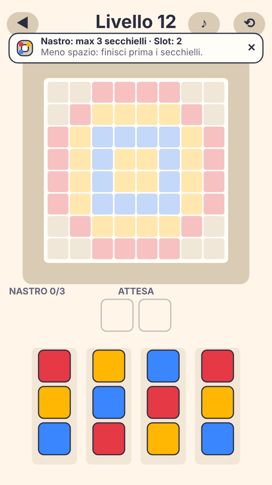
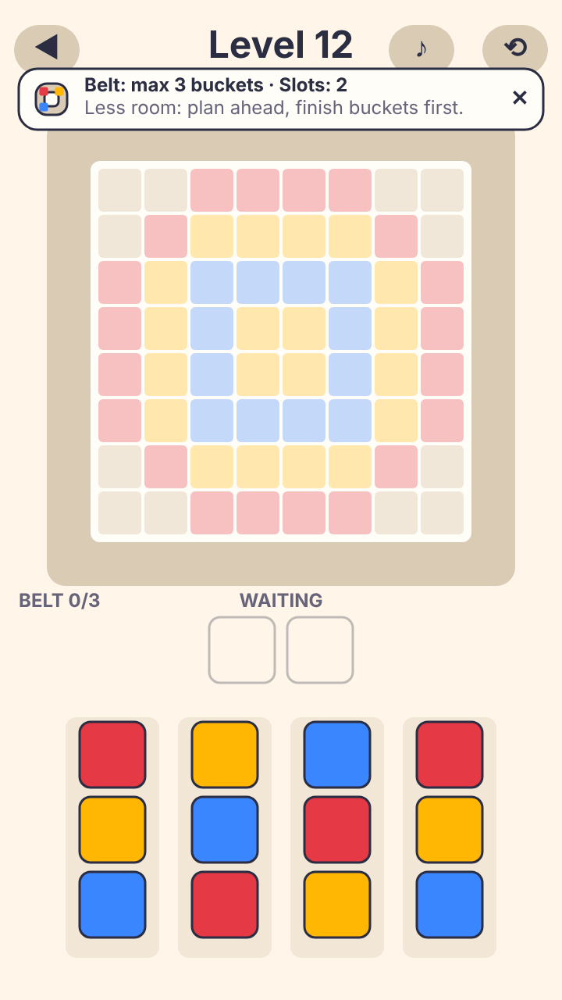
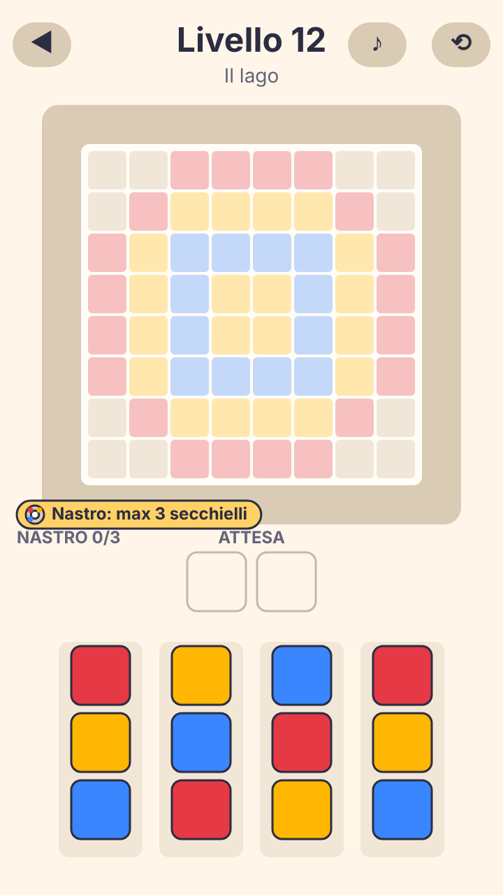
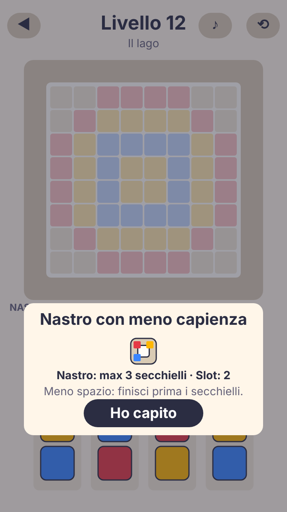

# #77 — Novità di difficoltà: tre direzioni per il messaggio

**Problema:** quando un livello fa un passo avanti (nastro con meno capienza, meno slot, quadro più grande, più colonne, secchielli più piccoli, boss) chi gioca lo scopre perdendo. Le schede già nel gioco spiegano le *meccaniche* (ghiaccio, nascosti, pietra, lucchetto, coperto…) ma nessuna dice che *un numero è cambiato*.

**Vincoli:** direzione "Gouache Studio" (`docs/design/README.md`), token solo da `src/game/theme.ts`, nessun colore come unica informazione, la partita resta visibile e giocabile a 360×640 (le colonne, gli slot e il nastro non si coprono), una riga di fatti più una di conseguenza, IT/EN.

Fotogrammi resi da codice: `scripts/design/77-mock.ts` disegna il livello 12 (nastro 4→3 e slot 3→2 insieme, quindi **un solo messaggio**) con i token e il layout veri; `node scripts/design/77-render.mjs` rigenera le immagini. L'icona è `drawChangeIcon` (`src/game/changeIcon.ts`), la stessa del gioco.

## A — "Striscia sotto il titolo"
Una striscia carta con bordo d'inchiostro, nella riga del sottotitolo: icona della novità a sinistra, il fatto in grassetto ("Nastro: max 3 secchielli · Slot: 2"), sotto la conseguenza ("Meno spazio: finisci prima i secchielli"), ✕ a destra. Non blocca nulla: la partita continua a essere giocabile, si chiude con un tocco sulla striscia (o al primo lancio). Occupa 78 unità sopra il nastro, dove non c'è niente da toccare.

 

## B — "Pastiglia sul contatore"
Una pastiglia dorata col solo fatto ("Nastro: max 3 secchielli") accanto al contatore "NASTRO 0/3", dove il numero vive. Non copre nulla, ma non dice cosa *comporta*, e per le altre novità (quadro, colonne, boss) non c'è un contatore a cui attaccarla.

## C — "Scheda sotto il nastro"
La scheda delle meccaniche: ombra sopra tutto e riquadro con titolo, icona, fatto, conseguenza e "Ho capito". È la più chiara, ma copre slot e colonne, mette in pausa la partita e a ogni passo di difficoltà aggiunge un altro stop obbligato (#177 ha già limitato le schede a una per livello proprio per questo).

## Scelta: A
- **Non ostruisce.** A sta nella riga del sottotitolo (sopra il nastro, nessun tocco da prendere); C copre slot e colonne a 360×640, B è piccola ma non spiega.
- **Dice cosa comporta.** Il ticket chiede "cosa è cambiato e cosa comporta": A ha il fatto e la conseguenza, B solo il fatto.
- **Una forma per ogni novità.** Funziona uguale per nastro, slot, quadro, colonne, secchielli e boss, ognuno con la sua icona (forma, non colore).
- **Sobria e coerente.** Stessi token della carta (carta, inchiostro, raggio `panel`), nessun movimento: niente da ridurre con `prefers-reduced-motion`.
- **Convive con le schede.** Se allo stesso livello parte anche una scheda di meccanica (C), la striscia è già lì sotto l'ombra: la scheda ha la precedenza visiva e la striscia si ritrova alla chiusura.

## Regole di cosa si annuncia
- Un solo messaggio per livello: nastro e slot che calano insieme sono una riga sola; poi il boss; poi un'altra novità (le altre aspettano un livello che le cambia di nuovo).
- Mostrato una volta per novità e salvato tra i suggerimenti (`chg.<tipo>`; per nastro e slot il numero a cui scendono: `chg.belt.2`), quindi un salvataggio vecchio non perde nulla e non serve migrazione.
- Soglie nella sola tabella `CHANGE_RULES` (`src/core/difficulty.ts`); confronto col livello precedente, e all'inizio di uno stage col livello d'apertura dello stage precedente (il boss che lo precede è un estremo per costruzione).
- Richiamabili in "Come si gioca": una pagina "Quando si fa più duro" elenca le novità incontrate.
