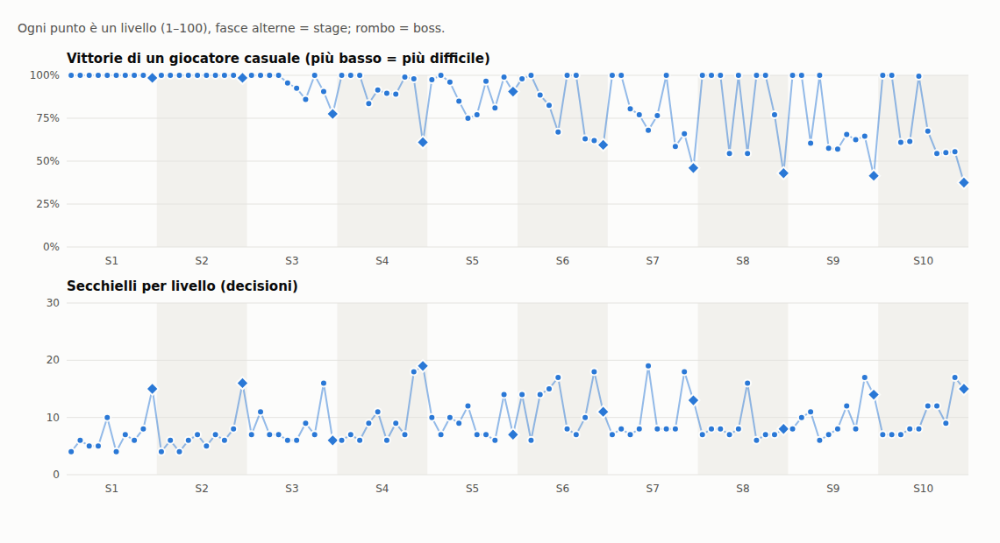

# Nastro e slot nella difficoltà: curva prima/dopo (ticket #75)

Data: 2 ottobre 2026 · Livelli: 100 (10 stage) · Dati per livello: [`curva-difficolta.json`](curva-difficolta.json) · Grafico: [`curva-difficolta.png`](curva-difficolta.png) · Rigenerare: `npx tsx scripts/difficulty-report.ts`

Decisione di partenza (commento del 2 ottobre su #75): capienza del nastro e slot d'attesa sono **tutte e due leve di difficoltà** e si misurano **insieme**; strada scelta: abbassare nastro e slot a gradini per stage e rigenerare i livelli, lasciando invariati gli stage 1–2.

## Come è misurata ora
- `levelWinRate(level)` in `src/core/solver.ts`: 200 partite con seed = id del livello, giocate **tick per tick con le regole di `sim.ts`** (`createGame`, `beltFull`, `launchFromColumn`, `launchFromSlot`, `step`, `boardGap` 1). Il giocatore casuale è "eager": a ogni tick, se il nastro ha posto, lancia un secchiello scelto a caso tra le teste di colonna e gli slot occupati.
- Vittoria = quadro completo. Sconfitta = ingorgo, oppure il limite di tick (secchielli × lunghezza del nastro × 30), che ferma i rilanci infiniti di secchielli bloccati.
- Una sola definizione: la usano il generatore (fasce `winRate`), i test e questo report. `solve` resta la prova di risolvibilità (un secchiello alla volta: aspettare il nastro vuoto è sempre possibile).
- Costo: circa 30 ms a livello; `npm run gen:levels -- --force` rigenera i 100 livelli in circa 4 s.
- Monotonia verificata su un livello su tre, con nastro 1–4 e slot 1–4: la peggiore "inversione" (meno spazio che risulta più facile) è dell'1%, cioè rumore di campionamento. Il test usa una tolleranza del 3%.

## Prima/dopo per stage
"Prima" = livelli spediti prima di #75 misurati con la misura nuova (la misura vecchia, un secchiello alla volta, è nell'ultima colonna come riferimento). "Dopo" = livelli rigenerati.

| Stage | Vittorie casuali (media) | Livello più duro | Boss | Nastro | Slot | Secchielli (media) | Misura vecchia (prima) |
|---|---|---|---|---|---|---|---|
| 1 Atelier | 100% → **100%** | 99% → 99% | 99% → 99% | 5 → 5 | 3–4 → 3–4 | 7.0 → 7.0 | 94% |
| 2 Frutta | 100% → **100%** | 99% → 99% | 99% → 99% | 4 → 4 | 3 → 3 | 6.9 → 6.9 | 98% |
| 3 Animali | 94% → **94%** | 72% → 78% | 89% → 78% | 4 → 2–3 | 2–3 → 2–3 | 9.9 → 8.2 | 73% |
| 4 Giardino | 96% → **91%** | 85% → 61% | 87% → 61% | 4 → 2–3 | 2–3 → 2–3 | 9.7 → 9.8 | 80% |
| 5 Mare | 92% → **90%** | 56% → 75% | 95% → 91% | 4 → 2–3 | 2–3 → 2–4 | 10.6 → 8.9 | 65% |
| 6 Città | 94% → **82%** | 55% → 60% | 96% → 60% | 4 → 2–3 | 2–3 → 2–3 | 14.5 → 12.0 | 77% |
| 7 Cibo | 97% → **77%** | 86% → 46% | 86% → 46% | 4 → 2–3 | 2–3 → 2–3 | 10.4 → 10.4 | 76% |
| 8 Veicoli | 88% → **83%** | 41% → 43% | 41% → 43% | 2 → 2 | 2–3 → 2–3 | 9.0 → 8.2 | 77% |
| 9 Spazio | 96% → **71%** | 80% → 42% | 80% → 42% | 3 → 2 | 2–3 → 2–3 | 10.9 → 10.1 | 75% |
| 10 Fantasia | 94% → **69%** | 74% → 38% | 85% → 38% | 3 → 2 | 2–3 → 2–3 | 10.6 → 10.2 | 73% |

A gruppi: stage 3–5 da 94% a 92%, stage 6–8 da 93% a 81%, stage 9–10 da 95% a 70%. Prima la curva era piatta (87–97% dallo stage 3 al 10) perché il nastro da 4 assorbiva gli ingorghi; ora scende a dente di sega.

## Cosa è cambiato nei livelli
- **Stage 1–2**: spec invariate, livelli identici byte per byte (verificato anche con `--force`).
- **Stage 3–10**: 80 livelli rigenerati, stessi id, nomi e immagini. Nastro cambiato in 70 livelli, slot in 35, inventario dei secchielli in 57; il pappagallo (#30, boss dello stage 3) passa da 3 a 4 colonne.
- **Nastro**: stage 3–4 nastro 3 con boss a 2; stage 5–7 nastro 3 nei primi cinque livelli e 2 negli ultimi cinque; stage 8–10 nastro 2. La capienza massima di uno stage non torna mai a crescere (5, 4, 3, 3, 3, 3, 3, 2, 2, 2).
- **Slot**: mai sotto 2; 2 nella maggior parte dei livelli centrali e finali, 3 nei livelli di respiro. In tre livelli gli slot salgono per tenerli **sotto** il boss in difficoltà: #29 Gatto 2→3, #41 Pesce 3→4 (primo dello stage 5), #44 Stella marina 2→3.
- **Fasce `winRate`**: ricalibrate sulla misura nuova; 1–3 livelli di respiro a inizio stage (fascia fino a 100%), poi in discesa fino al boss. Dove la figura lo permette il boss ha la fascia più bassa del suo stage e gli altri livelli stanno sopra.
- **Generazione**: tutti i 100 livelli nella fascia della loro spec al primo passo, **nessuno regolato automaticamente e nessuno "RELAXED"**.
- **Generatore e nastro**: valutato e scartato l'abbassamento automatico del nastro nello step di tuning. Il nastro è una leva visibile scelta per stage (indicatore "NASTRO n/N", messaggio quando cala in #77): se il generatore lo cambiasse da solo, la curva del nastro non sarebbe più leggibile né progettata. Nessun livello ne ha avuto bisogno; `POLICY_VERSION` resta 2 (la policy non è cambiata).

## Limiti ed eccezioni
1. **Figure senza ingorghi possibili per il giocatore casuale.** Alcune immagini si vincono al ~100% con qualsiasi combinazione provata (nastro 2–3, slot 2–4, secchielli da 0,35× a 2× della misura, più ghiaccio e pixel nascosti): #28 Cane, #38 Annaffiatoio, #47 Barca, #56 Ponte, #57 Fontana, #67 Pizza, #73 Camion, #75 Treno, #77 Elicottero, #78 Scooter, #84 Razzo, #95 Casa fungo. Hanno una fascia alta dichiarata (non "RELAXED") e funzionano come livelli di respiro anche se non sono a inizio stage. Il motivo è la forma: grandi aree di un colore raggiungibili da ogni lato, quindi ogni secchiello trova sempre dove sparare.
2. **Stage 8 (Veicoli) resta all'83%**, più facile dello stage 7 (77%): sette figure su dieci sono del tipo sopra. I tre livelli "veri" (#74, #76, #80) sono stati stretti a 43–55%. Per questo il test della curva confronta **gruppi** di stage (3–5, 6–8, 9–10), non i singoli stage.
3. **Boss dello stage 5 (#50 Faro, 91%) non è il più duro del suo stage** (#45 Polpo 75%, #46 Medusa 77%). Il minimo trovato per il faro è ~84% (nastro 2, slot 2, 5 colonne, secchielli più grandi, più ghiaccio). Renderlo il più duro avrebbe portato tutto lo stage 5 sopra il 90%, cioè a una curva che non scende. Proposta: cambiare la figura del boss o scambiarlo con un altro livello dopo il playtest.
4. **Il giocatore casuale non è una persona**: non vede la lettura delle tele grandi, il ghiaccio, i pixel nascosti, i tempi di reazione. La difficoltà percepita va confermata con i playtest (#66, #42).

## Per i ticket collegati
- **#72** (`levelDifficulty`): usare `levelWinRate`, nessuna seconda formula.
- **#77** (messaggio quando una leva cala): il nastro cala rispetto al livello prima ai livelli 11, 21, 30, 40, 46, 56 e 66 (dal 70→71 non cala più: lo stage 7 finisce già a 2); gli slot calano a 4, 23, 30, 34, 42, 43, 45, 53, 58, 63, 68, 74, 78, 83, 85, 93, 99. Al livello 30 calano tutti e due (un solo messaggio su una riga).
- **#67** (playtest): includere i cali di nastro sopra (es. 29→30, 45→46) nella copertura.
