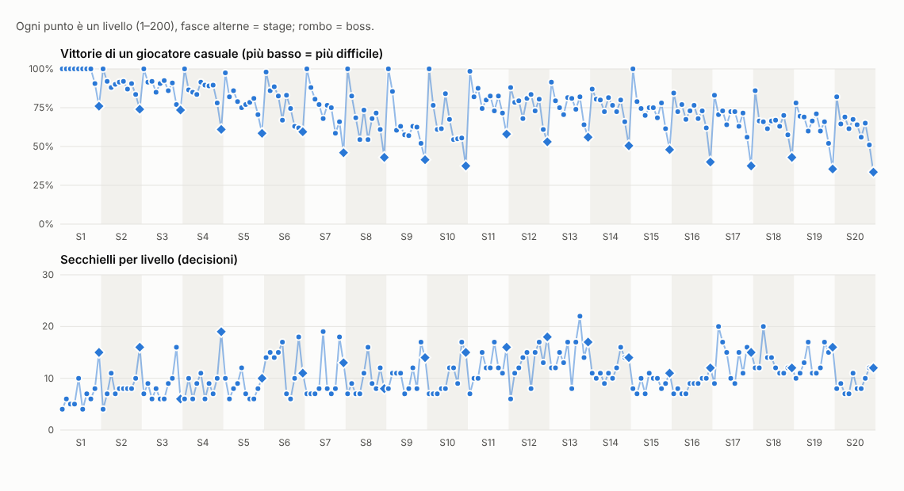

# Universo 2 "Natura": curva dei livelli 101–200 (ticket #100)

Data: 31 ottobre 2026 · Livelli: 200 (universi 1 e 2, stage 1–20; main `add72d4`) · Dati per livello: [`curva-difficolta.json`](curva-difficolta.json) · Grafico: [`curva-difficolta.png`](curva-difficolta.png) · Figure: [`docs/levels/`](../levels/) · Rigenerare: `npx tsx scripts/difficulty-report.ts` (nel container cloud: `CHROMIUM_PATH=/opt/pw-browsers/chromium npx tsx scripts/difficulty-report.ts`)

Obiettivo: il report della curva richiesto da #100 prima del rilascio dell'universo 2 ("Prima del rilascio: report della curva in `docs/reports/`"). È una misura, non un ritocco: **nessun livello e nessuna soglia cambiano** in questo ticket. I numeri sono quelli di `levelWinRate` (giocatore casuale, regole vere, 200 partite, seed = id), come nel [report dell'universo 1](2026-10-05-curva-universo-1.md).

## Risultato
- **Regole di #88**: `npm run gen:levels` dà **0 errori, 0 errori noti, 23 avvisi**, e tutti i 23 avvisi sono dell'universo 1 (gli stessi del report di #89). **Nei livelli 101–200 non c'è nessun avviso.**
- **Obiettivi di #100 rispettati**: primo stage 79% (obiettivo ~80%), ultimo stage 61% (obiettivo 62% ± 5%), boss più duro 34% (soglia ≥ 30%), inizio dell'universo 2 (79%) più facile della fine dell'universo 1 (65%) e più duro del suo inizio (97%).
- **Molto facili** (≥ 95%): solo **101 Ghianda** (debutto del marrone) e **141 Papaia** (debutto della pietra). Nessun primo di stage dell'universo 2 è molto facile, come vuole la regola 1.
- **Ogni 20 livelli qualcosa di nuovo**: sì, in tutte e cinque le finestre dell'universo 2 (101, 111, 122, 131, 141, 151, 161, 171, 181, 191).
- **Pixel secondari o marroni**: media per stage fra 65% e 84%, nessuna figura sotto il 30% dopo il primo livello dello stage.

## Curva per stage
Vittorie casuali con `levelWinRate`. "Più duro" è il livello con meno vittorie dello stage; in tutti gli stage dell'universo 2 è il boss. Secondari/marrone = quota media di pixel che richiedono una miscela (secondari e marrone); marrone = la sola quota marrone.

| Stage | Media | ≥ 95% | Livello più duro = boss | Nastro | Slot | Secondari/marrone | Marrone | Meccaniche (livelli) |
|---|---|---|---|---|---|---|---|---|
| 11 Bosco | **79%** | 1 (101) | 110 Quercia 58% | 2 | 2–3 | 80% | 35% | marrone 10 |
| 12 Montagna | **75%** | 0 | 120 Vetta 53% | 2 | 2 | 66% | 45% | ghiaccio 10, marrone 10 |
| 13 Prato | **76%** | 0 | 130 Mulino a vento 56% | 2 | 2–3 | 84% | 23% | nascosti 10, marrone 9 |
| 14 Deserto | **75%** | 0 | 140 Cammello 51% | 2 | 2 | 71% | 35% | ghiaccio 10, nascosti 10, marrone 10 |
| 15 Giungla | **73%** | 1 (141) | 150 Tempio perduto 48% | 2 | 2–3 | 66% | 0% | pietra 10 |
| 16 Fiume | **69%** | 0 | 160 Mulino ad acqua 40% | 2 | 2 | 65% | 0% | ghiaccio 10, pietra 10 |
| 17 Autunno | **66%** | 0 | 170 Fienile 38% | 2 | 2 | 79% | 34% | marrone 10, pietra 10 |
| 18 Inverno | **65%** | 0 | 180 Baita innevata 43% | 2 | 2 | 79% | 29% | ghiaccio 10, marrone 10, pietra 10 |
| 19 Notte nel bosco | **63%** | 0 | 190 Casa sull'albero 36% | 2 | 2 | 81% | 38% | nascosti 10, marrone 10, pietra 10 |
| 20 Vulcano | **61%** | 0 | 200 Eruzione **34%** | 2 | 2 | 66% | 18% | tutte e quattro, 10 ciascuna |

La curva scende dal 79% al 61% in dieci stage, con due tratti piani: **stage 12–14 fermi intorno al 75%** (13 Prato è un punto sopra il 12) e 17–18 (66 → 65%). Nessuna regola chiede che le medie scendano a ogni stage; nell'universo 1 lo stage 10 era già un punto sopra il 9. Il nastro è a 2 in tutti i 100 livelli e gli slot a 2 in 93: le leve numeriche sono finite, come previsto dall'epic #87, e la difficoltà viene dalle meccaniche e dalle figure. Tele fra 8×6 e 14×14 (limite di #100 rispettato).

Il salto più grande fra due livelli consecutivi è 22 punti (159 → 160, il boss del Fiume), poi 21 (141 → 142, l'uscita dal debutto della pietra) e 20 (118 → 119, il "duro travestito" della Montagna): sono i posti previsti dal dente di sega. Nessun livello non-boss dell'universo 2 scende sotto il 51%.

## Obiettivi di #100 e regole di #88

| Controllo | Obiettivo | Misura | Esito |
|---|---|---|---|
| Media del primo stage (11) | ~80% | 79% | ✓ |
| Media dell'ultimo stage (20), regola 5 | 62% ± 5% | 61% | ✓ |
| Boss più duro, regola 5 | ≥ 30% (− 3% di tolleranza) | 34% (200 Eruzione) | ✓ |
| Regola 4: inizio più facile della fine dell'universo 1 | stage 11 > stage 10 (65%) | 79% | ✓ |
| Regola 4: inizio più duro dell'inizio dell'universo 1 | stage 11 < stage 1 (97%) | 79% | ✓ |
| Regola 3: fine più dura dell'inizio (gruppi di due stage) | stage 19–20 < stage 11–12 − 3% | 62% contro 77% | ✓ |
| Regola 1: molto facile solo al debutto | — | solo 101 e 141 | ✓ |
| Regola 2: dente di sega, boss il più duro | — | 0 errori su 10 stage | ✓ |
| Regola 6 (avviso): ≥ 30% di secondari o marrone | — | 0 avvisi | ✓ |
| Regola 7 (avviso): livelli duri e boss corti | — | 0 avvisi | ✓ |
| Regola 8: nastro 1 o slot 1 | non prima dell'universo 3 | nastro e slot ≥ 2 ovunque | ✓ |

**Avvisi residui** (tutti nell'universo 1, invariati da #89): 14 di regola 6 (30, 34, 38, 42, 53, 72, 78, 80, 82, 84, 86, 89, 95, 96: figure a cornice, la difficoltà viene dal contorno e non dai secondari) e 9 di regola 7 (10, 20, 29, 40, 69, 70, 89, 99, 100: livelli duri lunghi; il tetto è provvisorio fino ai tempi di partita del playtest #66). Non riguardano questo universo.

## Marrone, pietra e combinazioni
**Novità** (primo livello di ogni meccanica e di ogni combinazione, dall'output del report):

| Livelli | Novità | Stage |
|---|---|---|
| 101 | **marrone** (debutto, 99%) | 11 Bosco |
| 111 | marrone + ghiaccio | 12 Montagna |
| 122 | marrone + nascosti | 13 Prato |
| 131 | marrone + ghiaccio + nascosti | 14 Deserto |
| 141 | **pietra** (debutto, 100%) | 15 Giungla |
| 151 | pietra + ghiaccio | 16 Fiume |
| 161 | **marrone + pietra** | 17 Autunno |
| 171 | marrone + pietra + ghiaccio | 18 Inverno |
| 181 | marrone + pietra + nascosti | 19 Notte nel bosco |
| 191 | tutte e quattro | 20 Vulcano |

Ogni finestra di 20 livelli dell'universo 2 (101–120, …, 181–200) ha almeno una novità, quindi il requisito "ogni 20 livelli qualcosa di nuovo" è soddisfatto. Il controllo, applicato da 21 in poi, trova una sola finestra vuota nel gioco: **81–100 dell'universo 1** (dopo ghiaccio + nascosti al 61 non arriva nulla di nuovo). È fuori da #100 e l'universo 1 è già uscito; lo segnalo nel messaggio finale.

**Pietra, misurata direttamente.** La pietra sta su celle vuote, quindi si può togliere senza cambiare l'inventario: stessi 60 livelli (141–200), 1000 partite casuali con e senza pietre, stesso seed. Togliere le pietre aggiunge in media **+13 punti** di vittorie (massimo +46 sul 150 Tempio perduto), più dei −4,2 misurati sul prototipo dell'epic #87: lì la pietra era aggiunta a figure dell'universo 1, qui le figure sono disegnate intorno alle pietre. In tre livelli la pietra **rende il livello più facile**: 164 Pettirosso (−7), 175 Ciuffolotto (−11) e 195 Roccia lavica (−5). Una pietra ferma anche i colpi che sarebbero finiti su un pixel sbagliato, quindi in questi tre fa da riparo invece che da ostacolo. Nessuna regola lo vieta e i tre livelli sono nella loro fascia, ma per il giocatore è una pietra "che aiuta", il contrario di quanto insegna il 141.

**Marrone, stimato.** Il marrone non si può togliere senza cambiare l'inventario (un pixel marrone consuma un colpo di ogni primario), quindi la misura è un confronto fra stage: con la pietra, gli stage con il marrone sono più duri di quelli senza (17 Autunno 66% contro 15 Giungla 73%, −7; 18 Inverno 65% contro 16 Fiume 69%, −4), in linea con i −7,3 del prototipo. Il confronto mescola marrone e posizione nell'universo, quindi è un ordine di grandezza, non una misura. Dentro uno stage la quota di marrone da sola non decide: il 116 (21% di marrone, 84%) e il 119 (76%, 61%) vanno nel verso atteso, ma il 105 (5% di marrone) e il 112 (48%) sono pari (80% e 79%), perché pesano anche la figura, il ghiaccio e la posizione nel dente di sega.

**Combinazioni.** Lo stage 17 (marrone + pietra) è il primo sotto il 70% e il suo boss (170 Fienile, 38%) è il più duro fino al 190; le combinazioni a tre e a quattro portano la media dal 66% al 61%. Il "−12,5" di marrone e pietra insieme del prototipo non si ritrova come salto fra stage, perché ogni stage riparte da un livello di respiro e le figure sono calibrate sulla fascia della spec: la difficoltà sale per gradini di 1–3 punti, che è lo scopo.

## Pixel secondari o marroni
#100 chiede ≥ 30% di pixel secondari o marroni dallo stage di debutto, salvo i livelli di respiro. Nell'universo 2 la quota media per stage va dal **65% (Fiume) all'84% (Prato)** e nessuna figura dopo il primo livello dello stage scende sotto il 30% (il valore più basso è il 132 Dune, 30%). Fra i livelli di respiro, solo il 161 Foglia d'acero è sotto (28%), ammesso dalla regola. La quota marrone da sola va dallo 0% degli stage 15–16 (solo pietra, come da piano) al 45% della Montagna; nello stage 20 è la più bassa fra gli stage con il marrone (18%), perché lì pesano ghiaccio, nascosti e pietra insieme. Con queste quote la regola 6 nell'universo 2 non scatta mai: il controllo resta utile per gli universi 3–5, dove le figure tornano senza marrone obbligato.

## Limiti e cosa resta a #69 e #42
1. **Il giocatore casuale non pianifica.** Spara a caso fra le mosse legali: misura quanto spazio c'è per sbagliare, non quanto un livello sia leggibile. Il marrone (tre colpi in qualunque ordine) e la pietra (colpi fermati) sono proprio le meccaniche in cui una persona che capisce la regola fa molto meglio del caso, quindi l'universo 2 potrebbe essere **più facile per una persona di quanto dicano i numeri**, soprattutto negli stage 17–20.
2. **Pietre che aiutano** (164, 175, 195): il caso le vede come riparo; una persona potrebbe non accorgersene affatto o trovarle incoerenti con il debutto. Va guardato nel playtest.
3. **Rumore**: 200 partite danno circa ±3 punti per livello (la tolleranza di `CURVE`); i confronti di questo report sono fra medie di stage (2000 partite) o, per la pietra, a 1000 partite per lato.
4. **Tempi di partita**: la regola 7 non scatta, ma il tetto è provvisorio; la durata vera dei livelli con marrone (più colpi per pixel) è da misurare.

**Cosa resta al playtest agent (#69)**: giocare l'universo 2 e segnalare i muri di difficoltà, in particolare ai boss 160 (40%), 170 (38%), 190 (36%) e 200 (34%), e ai salti 159 → 160 e 118 → 119; dire se il marrone e la pietra sono spiegati abbastanza al 101 e al 141; guardare i tre livelli in cui la pietra aiuta; dare i tempi di partita per tarare la regola 7. **Cosa resta a #42** (playtest con persone): la stessa domanda sul telefono con giocatori veri, e se il piano 12–14 (tre stage intorno al 75%) si sente come un plateau o come respiro prima della pietra.
