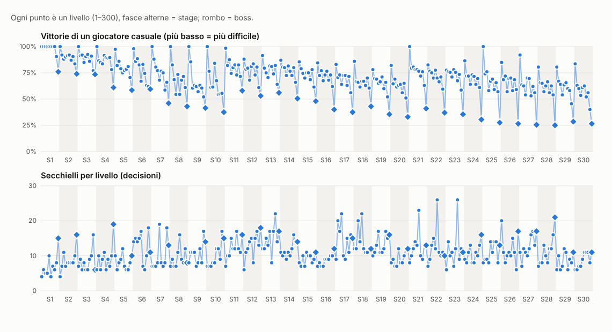

# Universo 3 "Viaggio": curva dei livelli 201–300 (ticket #208, epic #87)

Data: 19 novembre 2026 · Livelli: 300 (universi 1, 2 e 3, stage 1–30; main `f05e12d` + stage 30) · Dati per livello: [`curva-difficolta.json`](curva-difficolta.json) · Grafico: [`curva-difficolta.png`](curva-difficolta.png) · Figure: [`docs/levels/`](../levels/) · Rigenerare: `CHROMIUM_PATH=/opt/pw-browsers/chromium npx tsx scripts/difficulty-report.ts` (fuori dal container: `npx tsx scripts/difficulty-report.ts`)

Obiettivo: il report della curva che #208 chiede "alla fine dell'ultimo stage" prima del rilascio dell'universo 3 (#101), come per l'[universo 2](2026-10-31-curva-universo-2.md). È una **misura, non un ritocco**: oltre allo stage 30 (livelli 291–300) nessun livello e nessuna soglia cambiano. I numeri sono quelli di `levelWinRate` (giocatore casuale, regole vere, 200 partite, seed = id); il rumore è circa ±3 punti per livello, meno sulle medie di stage.



## Risultato
- **Regole di #88**: `npm run gen:levels` dà **0 errori nuovi, 0 noti, 28 avvisi**. Nessun avviso nei livelli 201–300 per la regola 6 (secondari); la regola 7 (livelli duri e boss lunghi) scatta su 240, 260, 270, 279 e 280, **nessuno dello stage 30**. Gli altri 23 avvisi sono dell'universo 1.
- **Obiettivi di #101 rispettati**: primo stage 74% (obiettivo ~74%), ultimo stage **56%** (obiettivo 56% ± 5%), boss più duro **25%** (280 Il Colosseo; soglia ≥ 25%, con la tolleranza di 3 punti di `CURVE`). Il boss dello stage 30 è al 26,5%.
- **Molto facili** (≥ 95%): solo **201** (debutto del lucchetto) e **241** (debutto dei secchielli coperti), cioè solo ai debutti, come vuole la regola 1.
- **Ogni 20 livelli qualcosa di nuovo**: sì in tutte e cinque le finestre (201–220, 221–240, 241–260, 261–280, 281–300). Vedi il punto debole qui sotto.
- **Fascia di difficoltà** (#72): nei 100 livelli dell'universo 3, 5 facili, 48 normali, 47 difficili; da stage 26 in poi lo stage è "Difficile". Lo stage 30 ha 1 normale (il respiro, 291) e 9 difficili.
- **Pixel secondari o marroni**: media per stage fra 62% (stage 26) e 91% (stage 28); nessuna figura dopo il livello di respiro sotto il 30% (la più bassa dello stage 30 è l'autoscontro, 37%).

## Curva per stage
| Stage | Media | ≥ 95% | Livello più duro = boss | Nastro | Slot | Secondari/marrone | Meccaniche (livelli) |
|---|---|---|---|---|---|---|---|
| 21 Stazione | **74%** | 1 (201) | 210 Stazione centrale 41% | 2 | 2–3 | 67% | marrone 9, lucchetto 10 |
| 22 Porto | **69%** | 0 | 220 Il porto 37% | 2 | 2 | 63% | marrone 10, lucchetto 10 |
| 23 Mercato | **69%** | 0 | 230 Il mercato 36% | 2 | 2 | 65% | marrone 9, pietra 10, lucchetto 10 |
| 24 Festa | **66%** | 0 | 240 La festa 31% | 2 | 2 | 69% | ghiaccio 10, nascosti 10, marrone 8, lucchetto 10 |
| 25 Musica | **65%** | 1 (241) | 250 Il concerto 28% | 2 | 2–3 | 67% | marrone 8, lucchetto 9, coperti 10 |
| 26 Sport | **63%** | 0 | 260 Lo stadio 27% | 2 | 2 | 62% | marrone 10, lucchetto 10, coperti 10 |
| 27 Circo | **61%** | 0 | 270 Il tendone 26% | 2 | 2 | 65% | marrone 7, lucchetto 10, coperti 10 |
| 28 Monumenti | **59%** | 0 | 280 Il Colosseo **25%** | 2 | 2 | 91% | marrone 10, pietra 10, lucchetto 10, coperti 1 |
| 29 Aeroporto | **59%** | 0 | 290 Il terminal 28% | 1–2 | 2–3 | 67% | ghiaccio 9, nascosti 9, marrone 9, pietra 10, lucchetto 10, coperti 10 |
| 30 Luna park | **56%** | 0 | 300 La ruota panoramica 27% | 1–2 | 2–3 | 78% | ghiaccio 9, nascosti 9, marrone 10, pietra 10, lucchetto 10, coperti 10 |

(Nomi come in gioco; le percentuali dei boss sono arrotondate: 300 vale 26,5%.) La media scende dal 74% al 56% in dieci stage, con due tratti piani: **22–23 (69%)** e **28–29 (59%)**. Nessuna regola chiede che scenda a ogni stage. Il nastro è a 2 in 98 livelli su 100 e a 1 solo nei due boss 290 e 300 (mai insieme a slot 1); gli slot arrivano a 3 solo in 201, 241 e nei due boss 290 e 300, mai sopra la fine dell'universo 2.

Le vittorie a caso dello stage 30, livello per livello: **83,5 · 63 · 60 · 53,5 · 61 · 62,5 · 52 · 56 · 40 · 26,5%** (media 55,8%). Il dente di sega è rispettato (respiro, base, "base+1", boss più duro dello stage). Il livello non-boss più duro dello stage è la nave dei pirati (299, 40%), il "duro" del 9.

I salti più grandi fra due livelli consecutivi sono tutti l'ingresso in un boss: 259 → 260 (−32,5 punti), 239 → 240 e 269 → 270 (−30,5), 249 → 250 (−29,5), 279 → 280 (−29): i posti previsti dal dente di sega. Il boss 300 si raggiunge con un salto di 13,5 punti (299 → 300), il più dolce dei dieci boss (290: 17; gli altri 22–32,5), perché il 299 è già al 40%.

## Obiettivi di #101 e regole di #88
| Controllo | Obiettivo | Misura | Esito |
|---|---|---|---|
| Media del primo stage (21) | ~74% | 74% | ✓ |
| Media dell'ultimo stage (30), regola 5 | 56% ± 5% | 56% | ✓ |
| Boss più duro, regola 5 | ≥ 25% (− 3% di tolleranza) | 25% (280) | ✓ |
| Regola 1: molto facile solo al debutto | — | solo 201 e 241 | ✓ |
| Regola 2: dente di sega, boss il più duro dello stage | — | 0 errori su 10 stage | ✓ |
| Regola 6 (avviso): ≥ 30% di secondari o marrone | — | 0 avvisi nei livelli 201–300 | ✓ |
| Regola 7 (avviso): livelli duri e boss corti | — | 5 avvisi (240, 260, 270, 279, 280), 0 nello stage 30 | avvisi noti |
| Regola 8: nastro 1 o slot 1 | non prima dell'universo 3; mai insieme | solo i boss 290 e 300, con 3 slot | ✓ |
| Nastro e slot mai sopra la fine dell'universo 2 | belt ≤ 2, slots ≤ 3 | rispettato | ✓ |

## Novità e combinazioni
Dall'output del report (primo livello di ogni meccanica e di ogni combinazione): **201 lucchetto** · 202 marrone+lucchetto · 221 marrone+pietra+lucchetto · 225 pietra+lucchetto · 231 ghiaccio+nascosti+marrone+lucchetto · 232 ghiaccio+nascosti+lucchetto · **241 secchielli coperti** · 242 marrone+lucchetto+coperti · 247 lucchetto+coperti · 275 marrone+pietra+lucchetto+coperti · **282 ghiaccio+nascosti+marrone+pietra+lucchetto+coperti** · 287 ghiaccio+nascosti+pietra+lucchetto+coperti. Finestre di 20 livelli senza novità: nessuna.

**Punto debole, da dire chiaramente.** L'ultima novità vera è **287**: lo stage 30 (291–300) non introduce nessuna meccanica né combinazione nuova, perché con tutte e sei le meccaniche già insieme dal 282 non ce n'è più. "Novità: tutto" nel ticket significa che nello stage compaiono tutte le meccaniche, non che ne arrivi una nuova. La finestra 281–300 è comunque coperta da 282 e 287, e quella 261–280 da un solo livello (275). Nello stage 30 la sorpresa viene dalle **figure** (luna park) e dal boss a nastro 1.

## Pietra, misurata direttamente
Lo stesso confronto del report dell'universo 2 (1000 partite con e senza pietre, stesso seed), ora su tutti i **103 livelli con pietra** (stage 9, 15–20, 23 e 28–30): togliere le pietre aggiunge in media **+12 punti** di vittorie (−5 minimo, +46 massimo). I livelli in cui la pietra **aiuta** (togliendola si perde) sono 8: 141, 184, 280, 286, **291, 296, 298 e 300**. Quattro sono dello stage 30, **boss compreso**: nel luna park la pietra sta su celle vuote e ferma colpi che sarebbero finiti su un pixel sbagliato, quindi per il giocatore casuale è un riparo. Nessuna regola lo vieta e tutti i livelli sono nella loro fascia, ma il boss 300 sarebbe **più difficile senza pietre**: se il playtest lo trova troppo facile per una persona, la leva è lì (togliere o spostare le pietre), non il nastro.

## Limiti e cosa resta al playtest
1. **Il giocatore casuale non pianifica**: misura lo spazio per sbagliare, non la leggibilità. Lucchetti, coperti e pietre sono meccaniche in cui chi capisce la regola fa molto meglio del caso: l'universo 3 può essere **più facile per una persona di quanto dicano i numeri**, soprattutto i boss 250–300.
2. **Stage 29–30 con ghiaccio + nascosti + marrone + pietra + lucchetto + coperti insieme**: è la combinazione più densa del gioco e non è mai stata giocata da una persona. La domanda aperta è il carico cognitivo, non la percentuale di vittorie.
3. **Boss a nastro 1** (290, 300): con nastro 1 e slot 2 il livello non si vince a caso (~0%), quindi hanno 3 slot; non sappiamo se per una persona l'ingorgo è leggibile o ingiusto (il tema dominante del playtest dell'universo 2).
4. **Regola 7**: il tetto sui secchielli dei livelli duri è provvisorio fino ai tempi di partita del playtest; 240, 260, 270, 279 e 280 lo superano.
5. **Rumore**: 200 partite danno circa ±3 punti per livello.

## Proposta: playtest agent sull'universo 3 (#66) — non eseguito
La decisione di eseguirlo è dell'utente: **non è stato lanciato**. Costi dalla guida [`scripts/playtest/README.md`](../../scripts/playtest/README.md): su #69 e #156 gli agent sono costati ~$120 a prezzo di listino (circa 14 agent; il rapporto 2026-10-31 conta 8 agent per ~26 livelli l'uno) cioè **~$0,3–0,5 per livello giocato da un agent**. La stima qui sotto è un ordine di grandezza da quel dato, non una misura sull'universo 3, i cui livelli sono più lunghi.

**Domande a cui risponde solo un giocatore**: i lucchetti (201) e i coperti (241) sono spiegati bene? la combinazione completa (282–300) è leggibile o pesante? i boss a nastro 1 (290, 300) sono un muro o un ingorgo ingiusto? 249 → 250, 259 → 260 e gli altri ingressi in boss sono muri?

**Config proposta del turno** (4 agent, 2 pack da ~10 livelli a testa, subagent su sonnet, un pack per sessione):
```json
{
  "turn": 1,
  "tag": "playtest-u3-1",
  "variant": "normale",
  "agents": [
    { "agentId": "A01", "profileId": "P01", "viewport": "360x640", "language": "it", "packs": ["S21", "S30"], "maxAttempts": 3 },
    { "agentId": "A02", "profileId": "P02", "viewport": "412x915", "language": "en", "packs": ["S25", "S29"], "maxAttempts": 3 },
    { "agentId": "A03", "profileId": "P03", "viewport": "412x915", "language": "it", "packs": ["S24", "S28"], "maxAttempts": 6 },
    { "agentId": "A04", "profileId": "P04", "viewport": "360x640", "language": "en", "packs": ["S26", "S27"], "maxAttempts": 4 }
  ]
}
```
Comando (dalla root del repo, shell host): `cd /percorso/mobile-game-first && npm ci && npm run playtest -- --config scripts/playtest/turn.example.json` con questo JSON al posto dell'esempio.

- **Costo stimato**: ~80 livelli giocati (4 × 2 pack × ~10) → **~$25–40 a listino** e **~1,5–3 ore** di orologio, con il rischio del limite d'uso dell'account (T02 dell'universo 2 è stato interrotto dal limite di 5 ore). Token: nell'ordine di **qualche milione di token di contesto riletto per agent**, dominati dalle schermate. Il tempo è una stima, non una misura.
- **Copertura**: un solo giro dà 1 agent per livello su 8 stage (21, 24–30) e ne salta 22 e 23. Il protocollo (§8) vuole ≥ 3 agent per livello: coprire i 100 livelli così costerebbe ~**$100–150** (tre giri come questo), quindi quasi tutto resterebbe ipotesi. Per spendere meno: un solo turno da 3 agent sui soli stage **25, 29 e 30** (debutto dei coperti, combinazione completa, boss finale), ~$15–25.
- **A/B "senza-copertura"** (`variant`): raddoppia il costo; solo se la domanda sui coperti resta aperta dopo il primo turno.
