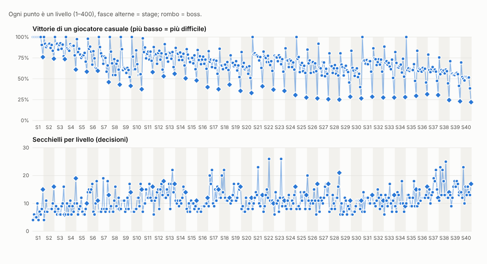

# Universo 4 "Mare e cielo": curva dei livelli 301–400 (ticket #245, epic #87)

Data: 24 novembre 2026 · Livelli: 400 (universi 1–4, stage 1–40; main `cd295eb` + stage 40) · Dati per livello: [`curva-difficolta.json`](curva-difficolta.json) · Grafico: [`curva-difficolta.png`](curva-difficolta.png) · Figure: [`docs/levels/`](../levels/) · Rigenerare: `CHROMIUM_PATH=/opt/pw-browsers/chromium npx tsx scripts/difficulty-report.ts` (fuori dal container: `npx tsx scripts/difficulty-report.ts`)

Obiettivo: il report della curva che #245 chiede alla fine dell'ultimo stage, prima del rilascio dell'universo 4 (#102), come per l'[universo 3](2026-11-19-curva-universo-3.md). È una **misura, non un ritocco**: oltre allo stage 40 (livelli 391–400) nessun livello e nessuna soglia cambiano. I numeri sono quelli di `levelWinRate` (giocatore casuale, regole vere, 200 partite, seed = id); il rumore è circa ±3 punti per livello, meno sulle medie di stage.

## Risultato
- **Regole di #88**: `npm run gen:levels` dà **0 errori nuovi, 0 noti, 28 avvisi**, **nessuno nei livelli 301–400** (tutti negli universi 1 e 3, gli stessi del report precedente). Le regole di fine universo (3 e 5) e quella di inizio (4) passano per l'universo 4.
- **Obiettivi di #102 rispettati**: primo stage **68%** (obiettivo ~68%), ultimo stage **48,7%** (obiettivo 50% ± 5%), boss più duro **22%**: è il **400**, il boss finale (soglia ≥ 22%). Gli altri nove boss stanno fra 23% (390) e 31,5% (360).
- **Molto facili** (≥ 95%): solo **301** (debutto della pellicola) e **341** (debutto delle gallerie), cioè solo ai debutti, come vuole la regola 1.
- **Ogni 20 livelli qualcosa di nuovo**: sì in tutte e cinque le finestre (301–320, 321–340, 341–360, 361–380, 381–400). Vedi il punto debole qui sotto.
- **Fascia di difficoltà** (#72): nei 100 livelli dell'universo 4, 4 facili, 30 normali, 66 difficili; dallo stage 33 in poi lo stage è "Difficile". Lo stage 40 ha 1 normale (il respiro, 391) e 9 difficili.
- **Pixel secondari o marroni**: media per stage fra 53% (stage 35) e 74% (stage 32); nessuna figura dopo il livello di respiro sotto il 30% (regola 6: 0 avvisi nei livelli 301–400).

## Curva per stage
| Stage | Media | ≥ 95% | Livello più duro = boss | Nastro | Slot | Secondari/marrone | Meccaniche (livelli) |
|---|---|---|---|---|---|---|---|
| 31 Spiaggia | **68%** | 1 (301) | 310 La spiaggia 28,5% | 2 | 2–3 | 54% | marrone 7, pellicola 10 |
| 32 Barriera corallina | **67%** | 0 | 320 La barriera corallina 27,5% | 2 | 2 | 74% | marrone 7, pellicola 10 |
| 33 Abissi | **64%** | 0 | 330 Il kraken 27,5% | 2 | 2 | 72% | marrone 5, lucchetto 10, pellicola 10 |
| 34 Isola | **62%** | 0 | 340 L'isola 28% | 2 | 2 | 72% | marrone 10, pietra 10, coperti 10, pellicola 10 |
| 35 Pirati | **61%** | 1 (341) | 350 Il capitano 29,5% | 2 | 2–3 | 53% | marrone 10, pietra 6, coperti 5, pellicola 8, gallerie 10 |
| 36 Nuvole | **59%** | 0 | 360 Il castello nel cielo 31,5% | 2 | 2 | 56% | marrone 6, pietra 8, coperti 5, pellicola 8, gallerie 10 |
| 37 Uccelli | **58%** | 0 | 370 L'uccello di fuoco 30,5% | 2 | 2 | 60% | marrone 10, pietra 8, coperti 5, pellicola 10, gallerie 10 |
| 38 Mongolfiere | **56%** | 0 | 380 La grande mongolfiera 24,5% | 2 | 2 | 66% | marrone 10, pietra 5, lucchetto 10, coperti 4, pellicola 4, gallerie 10 |
| 39 Temporale | **53%** | 0 | 390 La tempesta 23% | 2 | 2 | 63% | marrone 10, pietra 7, lucchetto 10, coperti 7, pellicola 7, gallerie 10 |
| 40 Arcobaleno | **49%** | 0 | 400 Il grande arcobaleno **22%** | 2 | 2 | 58% | marrone 10, pietra 7, lucchetto 10, coperti 7, pellicola 7, gallerie 10 |

(Nomi come in gioco; medie esatte: 68,05 · 67,05 · 64,25 · 62,25 · 60,95 · 58,7 · 58,0 · 55,55 · 52,55 · 48,7%.) La media scende dal 68% al 49% in dieci stage, **a ogni stage** (il passo più corto è 36 → 37, −0,7 punti). Nastro sempre a 2 e slot a 2, con 3 slot solo nei due debutti (301, 341): mai sopra la fine dell'universo 3, nessun boss a nastro 1 (a differenza di 290 e 300).

Le vittorie a caso, livello per livello (respiro · base · base · base+1 · base · base · base+1 · base · duro · boss):

| Stage | 1 | 2 | 3 | 4 | 5 | 6 | 7 | 8 | 9 | 10 (boss) |
|---|---|---|---|---|---|---|---|---|---|---|
| 31 | 100 | 71,5 | 72 | 68 | 72,5 | 67,5 | 71 | 71 | 58,5 | 28,5 |
| 32 | 86,5 | 74,5 | 73,5 | 66,5 | 70 | 73,5 | 67 | 73 | 58,5 | 27,5 |
| 33 | 88,5 | 69,5 | 71 | 67 | 69 | 64,5 | 61,5 | 73 | 51 | 27,5 |
| 34 | 82 | 69 | 63,5 | 63,5 | 65,5 | 67 | 57,5 | 74 | 52,5 | 28 |
| 35 | 100 | 60,5 | 62,5 | 59,5 | 61,5 | 60,5 | 60,5 | 67,5 | 47,5 | 29,5 |
| 36 | 83,5 | 59,5 | 62 | 61 | 58,5 | 63 | 60,5 | 62 | 45,5 | 31,5 |
| 37 | 79 | 60,5 | 58 | 61,5 | 64 | 59,5 | 61 | 58,5 | 47,5 | 30,5 |
| 38 | 75,5 | 55,5 | 60,5 | 58,5 | 60 | 56,5 | 61 | 59 | 44,5 | 24,5 |
| 39 | 71 | 56 | 56 | 54,5 | 54,5 | 56,5 | 57 | 55,5 | 41,5 | 23 |
| 40 | 69,5 | 52 | 50 | 48 | 52,5 | 52 | 51 | 51,5 | 38,5 | **22** |

Il dente di sega è rispettato in tutti e dieci gli stage (regola 2: 0 errori). Nello stage 40 la base (mediana delle posizioni 2, 3, 5, 6, 8) è 52%: i due "base+1" (394 al 48%, 397 al 51%) non sono più facili della base, il duro (399, doppio arcobaleno) è 13,5 punti sotto, e il boss è il più duro dello stage e dell'universo.

I salti più grandi fra due livelli consecutivi: **341 → 342 (−39,5 punti)**, l'uscita dal debutto "molto facile" delle gallerie; poi l'ingresso nei boss 320 (−31) e 310 (−30), 301 → 302 (−28,5, l'uscita dal debutto della pellicola), l'ingresso nel boss 340 (−24,5), 351 → 352 (−24) e l'ingresso nel boss 330 (−23,5). Il boss finale 400 si raggiunge con un salto di 16,5 punti (399 → 400), fra i più dolci dei dieci boss perché il 399 è già al 38,5%.

## Obiettivi di #102 e regole di #88
| Controllo | Obiettivo | Misura | Esito |
|---|---|---|---|
| Media del primo stage (31) | ~68% | 68,05% | ✓ |
| Media dell'ultimo stage (40), regola 5 | 50% ± 5% | 48,7% | ✓ |
| Boss più duro, regola 5 | ≥ 22% (− 3% di tolleranza) | 22% (400, il boss finale) | ✓ |
| Regola 3: fine dell'universo più dura dell'inizio (stage 39–40 contro 31–32) | almeno 3 punti sotto | 50,6% contro 67,6% | ✓ |
| Regola 4: l'universo 4 parte più facile di come finisce il 3 e più duro di come parte il 3 | 56% < media dello stage 31 < 74% | 68% | ✓ |
| Regola 1: molto facile solo al debutto | — | solo 301 (pellicola) e 341 (gallerie) | ✓ |
| Regola 2: dente di sega, boss il più duro dello stage | — | 0 errori su 10 stage | ✓ |
| Regola 6 (avviso): ≥ 30% di secondari o marrone | — | 0 avvisi nei livelli 301–400 | ✓ |
| Regola 7 (avviso): livelli duri e boss corti | — | 0 avvisi nei livelli 301–400 | ✓ |
| Regola 8: nastro 1 o slot 1 | mai insieme | mai usati nell'universo 4 | ✓ |
| Nastro e slot mai sopra la fine dell'universo 3 | belt ≤ 2, slots ≤ 3 | belt 2, slots 2–3 | ✓ |

## Novità e combinazioni
Dall'output del report (primo livello di ogni meccanica e di ogni combinazione): **301 pellicola** · 302 marrone+pellicola · 321 lucchetto+pellicola · 322 marrone+lucchetto+pellicola · 331 marrone+pietra+coperti+pellicola · **341 gallerie** · 342–357 le gallerie con marrone, pietre, coperti e pellicola (dieci combinazioni) · 371 marrone+lucchetto+gallerie · 373–377 lucchetto e gallerie con pellicola, pietre e coperti · **379 marrone+pietra+lucchetto+coperti+pellicola+gallerie** · 382 marrone+pietra+lucchetto+pellicola+gallerie · 384 marrone+pietra+lucchetto+coperti+gallerie. Finestre di 20 livelli senza novità: nessuna.

**Punto debole, da dire chiaramente.** Come per lo stage 30, l'ultima novità vera è **384**: lo stage 40 (391–400) non introduce nessuna meccanica né combinazione nuova, perché tutte le meccaniche dell'universo stanno insieme dal 379. "Novità: tutto" nel ticket significa che nello stage compaiono tutte le meccaniche, non che ne arrivi una nuova. Nello stage 40 la sorpresa viene dalle **figure** (arcobaleni) e dal boss più duro dell'universo, con 2 chiavi e 3 lucchetti.

## Pietra, misurata direttamente
Lo stesso confronto dei report precedenti (1000 partite con e senza pietre, stesso seed), ora su tutti i **154 livelli con pietra**: togliere le pietre aggiunge in media **+10 punti** di vittorie (−5 minimo, +46 massimo). I livelli in cui la pietra **aiuta** (togliendola si perde) sono 11; quelli dell'universo 4 sono **337, 368 e 369**. **Nessuno dello stage 40**, boss compreso: il 400 è più difficile *con* le sue 3 pietre, quindi se il playtest lo trova troppo duro per una persona, togliere una pietra è una leva in più oltre ai lucchetti.

## Limiti e cosa resta al playtest
1. **Il giocatore casuale non pianifica**: misura lo spazio per sbagliare, non la leggibilità. Pellicola, gallerie e lucchetti sono meccaniche in cui chi capisce la regola fa molto meglio del caso: l'universo 4 può essere **più facile per una persona di quanto dicano i numeri**, soprattutto dallo stage 38 in poi.
2. **Stage 39–40 con gallerie + lucchetto + marrone + pellicola + pietre + coperti insieme**: è la combinazione più densa dell'universo e non è mai stata giocata da una persona. La domanda aperta è il carico cognitivo, non la percentuale di vittorie.
3. **Gallerie** (dal 341): il salto 341 → 342 (−39,5 punti) è il più grande dell'universo; non sappiamo se per una persona il primo livello "vero" con le gallerie sia un muro.
4. **Regola 7**: il tetto sui secchielli dei livelli duri è provvisorio fino ai tempi di partita del playtest; nell'universo 4 nessun livello lo supera.
5. **Rumore**: 200 partite danno circa ±3 punti per livello; il boss 400 (22%) e il 390 (23%) sono a un passo di misura, quindi "il più duro dell'universo" vale per il giocatore casuale con questi seed, non come distanza percepibile.
6. **Fine dell'universo**: vincere il 400 apre la festa dell'universo 4 (mosaico e stile di secchiello "bolle"); senza universo 5 la scheda dice che il prossimo è in arrivo, come accadeva alla fine dell'universo 3 prima dello stage 31.

## Playtest agent sull'universo 4 (#66) — non eseguito
Il ticket chiede un playtest agent sull'universo prima del rilascio (#102). La decisione di eseguirlo spetta all'utente (costo): **non è stato lanciato** in questo ticket. Le domande che solo un giocatore può chiarire: la pellicola (301) e le gallerie (341) sono spiegate bene? Il 342 è un muro? La combinazione completa (379–400) è leggibile o pesante? Il boss finale 400 è duro ma giusto? Guida, costi di riferimento e formato del turno: [`scripts/playtest/README.md`](../../scripts/playtest/README.md) e il report dell'[universo 3](2026-11-19-curva-universo-3.md#proposta-playtest-agent-sulluniverso-3-66--non-eseguito) (~$0,3–0,5 per livello giocato da un agent; un turno da 3–4 agent sugli stage 31, 35, 39 e 40 costerebbe nell'ordine di $15–40).
