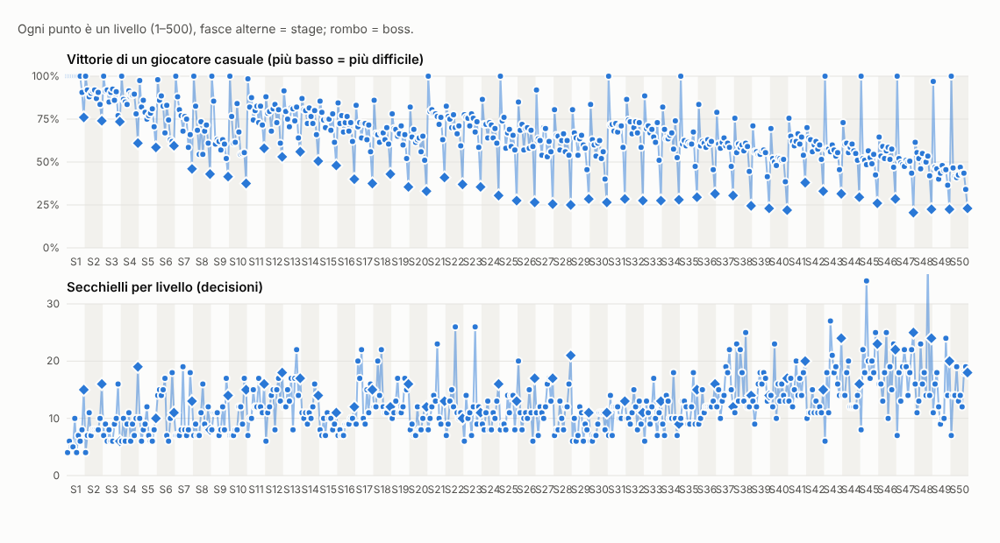

# Universo 5 "Cosmo": curva dei livelli 401–500 (ticket #275, epic #103)

Data: 27 novembre 2026 · Livelli: 500 (universi 1–5, stage 1–50; main `d5c4168` + stage 50) · Dati per livello: [`curva-difficolta.json`](curva-difficolta.json) · Grafico: [`curva-difficolta.png`](curva-difficolta.png) · Figure: [`docs/levels/`](../levels/) · Rigenerare: `CHROMIUM_PATH=/opt/pw-browsers/chromium npx tsx scripts/difficulty-report.ts` (fuori dal container: `npx tsx scripts/difficulty-report.ts`)

Obiettivo: il report della curva che #275 chiede alla fine dell'ultimo stage, prima del rilascio dell'universo 5 (#103), come per l'[universo 4](2026-11-24-curva-universo-4.md). Con lo stage 50 il gioco arriva a 500 livelli e l'universo 5 è completo. È una **misura, non un ritocco**: oltre allo stage 50 (livelli 491–500) nessun livello e nessuna soglia cambiano. I numeri sono quelli di `levelWinRate` (giocatore casuale, regole vere, 200 partite, seed = id); il rumore è circa ±3 punti per livello, meno sulle medie di stage.

## Risultato
- **Regole di #88**: `npm run gen:levels` dà **0 errori nuovi, 0 noti, 30 avvisi**; nei livelli 401–500 ci sono solo i due avvisi della regola 7 sui boss 480 e 490 (tetto provvisorio dei secchielli), nessuno sul 500. Le regole di fine universo (3 e 5) e quella di inizio (4) passano per l'universo 5.
- **Obiettivi di #103 rispettati**: primo stage **61%** (obiettivo ~62%), ultimo stage **46,3%** (obiettivo 45% ± 5%), boss più duro **20,5%** (470, l'idra; soglia ≥ 20%). Il boss finale **500** è al **23%**: il più duro del suo stage, ma non dell'universo (vedi "Punti deboli").
- **Molto facili** (≥ 95%): **421, 441, 461, 481, 491**, cioè solo i cinque debutti delle coppie e della combinazione finale, come vuole la regola 1.
- **Ogni 20 livelli qualcosa di nuovo**: sì in tutte e cinque le finestre (401–420, 421–440, 441–460, 461–480, 481–500).
- **Fascia di difficoltà** (#72): nei 100 livelli dell'universo 5, 5 facili (i debutti), 5 normali, 90 difficili; ogni stage è "Difficile". Lo stage 50 ha 1 facile (il debutto, 491) e 9 difficili.
- **Pixel secondari o marroni**: media per stage fra 56% (stage 41) e 76% (stage 47); nessuna figura sotto il 30% (regola 6: 0 avvisi nei livelli 401–500).

## Curva per stage
| Stage | Media | ≥ 95% | Livello più duro = boss | Nastro | Slot | Secondari/marrone | Meccaniche (livelli) |
|---|---|---|---|---|---|---|---|
| 41 Sistema solare | **61%** | 0 | 410 Il sistema solare 38% | 2 | 2 | 56% | marrone 10, lucchetto 10 |
| 42 Cielo stellato | **58%** | 0 | 420 Il cielo stellato 33% | 2 | 2 | 57% | marrone 10, pietra 5, lucchetto 10, pellicola 7 |
| 43 Robot | **57%** | 1 (421) | 430 Il robottone 31,5% | 2 | 2 | 68% | ghiaccio 10, marrone 5, lucchetto 5, pellicola 10 |
| 44 Laboratorio | **56%** | 0 | 440 L'esperimento 29,5% | 2 | 2 | 65% | ghiaccio 4, marrone 9, pietra 3, lucchetto 9, pellicola 8 |
| 45 Sogni | **53%** | 1 (441) | 450 Il sognatore 26% | 2 | 2 | 65% | ghiaccio 10, marrone 6, lucchetto 5, gallerie 10 |
| 46 Cristalli | **53%** | 0 | 460 Il golem 28,5% | 2 | 2 | 71% | ghiaccio 8, marrone 6, pietra 1, lucchetto 6, pellicola 5, gallerie 4 |
| 47 Mito | **51%** | 1 (461) | 470 L'idra **20,5%** | 2 | 2 | 76% | nascosti 10, marrone 5, lucchetto 5, pellicola 10 |
| 48 Galassia | **49%** | 0 | 480 Andromeda 22,5% | 2 | 2 | 66% | ghiaccio 5, nascosti 3, marrone 8, pietra 1, lucchetto 8, pellicola 6, gallerie 3 |
| 49 Buchi neri | **47%** | 1 (481) | 490 Il divoratore 22,5% | 2 | 2 | 71% | nascosti 10, marrone 5, lucchetto 5, gallerie 10 |
| 50 Finale | **46%** | 1 (491) | 500 Il gran finale 23% | 2 | 2 | 65% | ghiaccio 10, nascosti 10, pellicola 10, gallerie 10, marrone 5, lucchetto 5 |

(Medie esatte: 60,75 · 57,7 · 57,4 · 56,1 · 53,25 · 52,85 · 51,3 · 48,8 · 47,1 · 46,25%.) La media scende dal 61% al 46% in dieci stage, **a ogni stage** (il passo più corto è 42 → 43, −0,3 punti; 45 → 46, −0,4). Nastro sempre a 2 e slot sempre a 2: mai sopra la fine dell'universo 4, nessun boss a nastro 1 o slot 1.

Le vittorie a caso, livello per livello (respiro · base · base · base+1 · base · base · base+1 · base · duro · boss):

| Stage | 1 | 2 | 3 | 4 | 5 | 6 | 7 | 8 | 9 | 10 (boss) |
|---|---|---|---|---|---|---|---|---|---|---|
| 41 | 75,5 | 65 | 62 | 59,5 | 62 | 66,5 | 60,5 | 64,5 | 54 | 38 |
| 42 | 70 | 64 | 63 | 56 | 60 | 62 | 57,5 | 60 | 51,5 | 33 |
| 43 | 100 | 57,5 | 57,5 | 56 | 60 | 57 | 53,5 | 55,5 | 45,5 | 31,5 |
| 44 | 73 | 60,5 | 61 | 55,5 | 58,5 | 60,5 | 56,5 | 55 | 51 | 29,5 |
| 45 | 100 | 52 | 51 | 48,5 | 56,5 | 52,5 | 49 | 54,5 | 42,5 | 26 |
| 46 | 64,5 | 53,5 | 59 | 52 | 56,5 | 58,5 | 51,5 | 57,5 | 47 | 28,5 |
| 47 | 100 | 52 | 49,5 | 48,5 | 47,5 | 51 | 50 | 50,5 | 43,5 | 20,5 |
| 48 | 61,5 | 55,5 | 52 | 46 | 55 | 50 | 50 | 53,5 | 42 | 22,5 |
| 49 | 97 | 47 | 46 | 40 | 43,5 | 48 | 45 | 45,5 | 36,5 | 22,5 |
| 50 | 100 | 46,5 | 41,5 | 41 | 42,5 | 47 | 43,5 | 43,5 | 34 | **23** |

Il dente di sega è rispettato in tutti e dieci gli stage (regola 2: 0 errori). Nello stage 50 la base (mediana delle posizioni 2, 3, 5, 6, 8) è 43,5%: i due "base+1" (494 al 41%, 497 al 43,5%) non sono più facili della base, il duro (499, i fuochi) è 9,5 punti sotto, e il boss 500 è il più duro dello stage.

I salti più grandi fra due livelli consecutivi sono tutti all'uscita dai debutti "molto facili": **491 → 492 (−53,5 punti)**, 481 → 482 (−50), 461 → 462 e 441 → 442 (−48), 421 → 422 (−42,5). Fra i boss, l'ingresso più ripido è 469 → 470 (−23).

## Obiettivi di #103 e regole di #88
| Controllo | Obiettivo | Misura | Esito |
|---|---|---|---|
| Media del primo stage (41) | ~62% | 60,75% | ✓ |
| Media dell'ultimo stage (50), regola 5 | 45% ± 5% | 46,25% | ✓ |
| Boss più duro, regola 5 | ≥ 20% (− 3% di tolleranza) | 20,5% (470) | ✓ |
| Boss finale 500 | il più duro dello stage e ≥ 20% | 23% (499 al 34%) | ✓ |
| Regola 3: fine dell'universo più dura dell'inizio (stage 49–50 contro 41–42) | almeno 3 punti sotto | 46,7% contro 59,2% | ✓ |
| Regola 4: l'universo 5 parte più facile di come finisce il 4 e più duro di come parte il 4 | 48,7% < media dello stage 41 < 68% | 60,75% | ✓ |
| Regola 1: molto facile solo al debutto | — | solo 421, 441, 461, 481, 491 | ✓ |
| Regola 2: dente di sega, boss il più duro dello stage | — | 0 errori su 10 stage | ✓ |
| Regola 6 (avviso): ≥ 30% di secondari o marrone | — | 0 avvisi nei livelli 401–500 | ✓ |
| Regola 7 (avviso): livelli duri e boss corti | — | 480 (24 secchielli, tetto 21) e 490 (20, tetto 17); 500 ne ha 18, tetto 19 | ⚠ provvisorio |
| Regola 8: nastro 1 o slot 1 | mai insieme | mai usati nell'universo 5 | ✓ |
| Nastro e slot mai sopra la fine dell'universo 4 | belt ≤ 2, slots ≤ 2 | belt 2, slots 2 | ✓ |

## Novità e combinazioni
Dall'output del report (primo livello di ogni combinazione): 416 marrone+pietra+lucchetto+pellicola · **421 ghiaccio+pellicola** · 424 ghiaccio+marrone+lucchetto+pellicola · **441 ghiaccio+galleria** · 442 ghiaccio+marrone+lucchetto+galleria · 447 ghiaccio+marrone+galleria · **461 nascosti+pellicola** · 462 nascosti+marrone+lucchetto+pellicola · **481 nascosti+galleria** · 482 nascosti+marrone+lucchetto+galleria · **491 ghiaccio+nascosti+pellicola+galleria** · 492 la stessa con marrone e lucchetti. Finestre di 20 livelli senza novità: nessuna, in tutto il gioco (dal 21).

**La combinazione finale (stage 50).** Il ticket chiedeva "tutte le coppie insieme". Scelta: in **ogni** livello dello stage 50 ci sono insieme ghiaccio, pellicola, pixel nascosti e una galleria, cioè le quattro coppie dell'universo (ghiaccio+pellicola, ghiaccio+galleria, nascosti+pellicola, nascosti+galleria) nello stesso quadro. È una combinazione mai vista (nessun livello prima del 491 ha i quattro insieme), con la sua card di debutto "Tutto insieme" (`allPairs`) al 491. Per restare giusta: un solo segno per pixel (mai ghiaccio e pellicola sullo stesso pixel), ghiaccio solo su primari, pellicole mai sul marrone né su un pixel che ha già il loro colore, ogni "?" con accanto un pixel visibile, niente pietre e niente secchielli coperti; marrone con chiavi e lucchetti solo su metà dei livelli. **Il solver la dimostra risolvibile su tutti e dieci i livelli**: nessuna sostituzione è servita.

## Pietra, misurata direttamente
Lo stesso confronto dei report precedenti (1000 partite con e senza pietre, stesso seed), ora su tutti i **164 livelli con pietra**: togliere le pietre aggiunge in media **+10 punti** di vittorie (−5 minimo, +46 massimo). Nell'universo 5 le pietre sono poche (stage 42, 44, 46, 48) e solo nel **420** aiutano (togliendole si perde). Lo stage 50 non ne ha.

## Punti deboli, da dire chiaramente
1. **Il boss finale non è il boss più duro del gioco** per il giocatore casuale: 500 al 23%, 470 (l'idra) al 20,5%. La differenza (2,5 punti) è dentro il rumore di 200 partite (±3), e il ticket chiede solo che il 500 sia il più duro dello stage e sopra il 20%. Ho provato a portarlo al 20% cercando un'altra distribuzione dei secchielli: in 86 tentativi nessuna cade fra 19,5% e 21% (le partite "saltano" fra 14% e 23%), quindi non l'ho forzato. Se il playtest lo vuole più duro, la leva è un lucchetto o un "?" in più.
2. **Il giocatore casuale non pianifica**: misura lo spazio per sbagliare, non la leggibilità. Nello stage 50 ci sono quattro ostacoli diversi nello stesso quadro (più marrone e lucchetti su metà dei livelli): la domanda aperta è il **carico cognitivo**, non la percentuale.
3. **Uscite dai debutti**: 491 → 492 (−53,5 punti) è il salto più grande del gioco. Non sappiamo se per una persona il primo livello "vero" con i quattro insieme sia un muro.
4. **Regola 7**: il tetto sui secchielli dei boss è provvisorio fino ai tempi di partita del playtest; 480 e 490 lo superano.
5. **Fine del gioco**: vincere il 500 mostra "Universo completato!" e la festa dell'universo 5. La festa finale e il murale dei cinque universi sono il ticket #91, non questo.

## Prossimi passi (non fatti in questo ticket)
- **Playtest agent sull'universo 5 (#66)**, prima del rilascio (#103): la decisione spetta all'utente (costo), **non è stato lanciato**. Domande che solo un giocatore può chiarire: le card delle coppie (421, 441, 461, 481) e "Tutto insieme" (491) sono chiare? Il 492 è un muro? I quattro ostacoli insieme sono leggibili o pesanti? Il gran finale 500 è duro ma giusto? Guida e costi: [`scripts/playtest/README.md`](../../scripts/playtest/README.md); un turno da 3–4 agent sugli stage 41, 45, 49 e 50 costerebbe nell'ordine di $15–40 come per l'universo 4.
- **Festa finale e murale dei 5 universi (#91)**.
